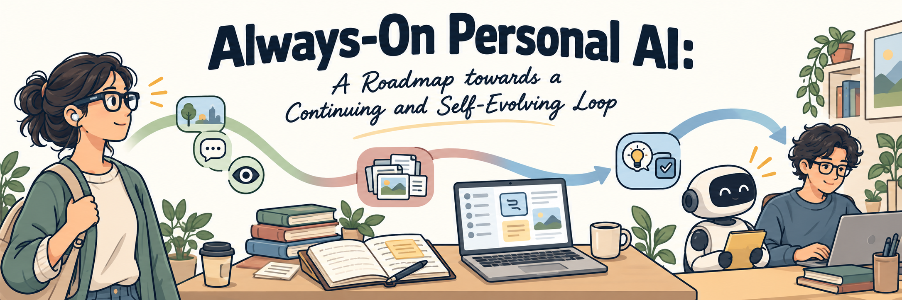
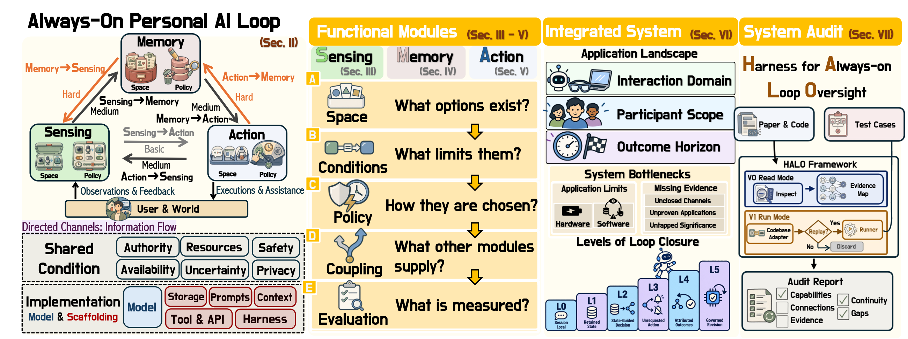

<!-- Generated by scripts/build_readme.py. Edit data/*.json or docs/readme-*.md, then regenerate. -->

<div align="center">



<p>
  <b>The reading list of <i>Always-On Personal Intelligence: A Roadmap Towards Continuing, Self-Evolving Loops</i>,<br/>
  arranged by the survey's own sections.</b>
</p>

<p>
  
  <a href="https://always-on-intelligence.github.io/"></a>
</p>

<p>
  <a href="https://github.com/Always-On-Intelligence/awesome-always-on-personal-intelligence/stargazers"></a>
  
  
  <a href="LICENSE"></a>
</p>

<sub>Continuously updated · Contributions are welcome</sub>

</div>

<details>
<summary><b>Table of Contents</b></summary>

- [News](#news)
- [Overview](#overview)
- [Foundations](#foundations)
- [Sensing](#sec-3) (111)
  - [Sensing Space](#sec-3-1)
  - [Operating Conditions for Sensing](#sec-3-2)
  - [Sensing Policy](#sec-3-3)
  - [Sensing Coupling Across the Loop](#sec-3-4)
  - [Evaluation](#sec-3-5)
- [Memory](#sec-4) (83)
  - [Memory Space](#sec-4-1)
  - [Memory Policy](#sec-4-3)
  - [Memory Coupling Across the Loop](#sec-4-4)
  - [Evaluation](#sec-4-5)
- [Action](#sec-5) (79)
  - [Action Space](#sec-5-1)
  - [Operating Conditions for Action](#sec-5-2)
  - [Action Policy](#sec-5-3)
  - [Action Coupling Across the Loop](#sec-5-4)
  - [Evaluation](#sec-5-5)
- [Applications, System Bottlenecks, and Loop Closure](#sec-6) (97)
  - [Applications and Bottlenecks](#sec-6-1)
  - [Shared Conditions and Implementation Across Modules](#sec-6-2)
  - [Levels of Loop Closure](#sec-6-3)
  - [Self-Evolution in Deployed Loops](#sec-6-4)
- [Trends and Open Problems](#sec-8) (24)
  - [Local Policies for Always-On Assistance](#sec-8-1)
  - [Self-Evolution and Recursive Revision](#sec-8-3)
  - [Longitudinal Evaluation and Real Deployment](#sec-8-4)
- [Related Surveys](#related-surveys) (35)
- [Products & Tools](#products) (91)
  - [Wearable Products](#products-wearable)
  - [Digital Products](#products-digital)
  - [Physical Products](#products-physical)
  - [Devices & Platforms](#products-devices)
  - [Product Directory](#products-list)
  - [Developer Tools](#products-tools)
- [Contributing](#contributing)
- [Citation](#citation)

</details>

---

<a id="news"></a>
## News

- **[2026/10]** Research works and products are now listed apart: official product pages, documentation, and blogs moved to Products & Tools, grouped by wearable, digital, and physical domain.
- **[2026/10]** The list starts directly with the modules, without section numbers. Each list runs from the newest work to the oldest, related surveys sit near the end, and background works such as textbooks are left out.
- **[2026/10]** Synced with the latest draft, now titled *Always-On Personal Intelligence: A Roadmap Towards Continuing, Self-Evolving Loops*: **500 works**, the revised memory policy subsections, and the new product rows of the loop-closure table.
- **[2026/10]** The list follows the survey's chapters, titles, and terms: within each module, space, operating conditions, policy, coupling, and evaluation.
- **[2026/09]** The collection became a reading list of the works cited in our survey, with code links where available.

---

<a id="overview"></a>
## Overview

The promise of always-on personal intelligence lies in a **continuing, self-evolving loop**. It must sustain assistance between requests, retain personal context, and carry unfinished commitments forward. Self-evolution extends the continuing loop through self-revisions from operating experience.

> [!IMPORTANT]
> **The survey connects Sensing, Memory, and Action through six directed coupling channels. These modules operate under real-world conditions, such as privacy and authority, and are realized by an implementation of models and scaffolding.**

<div align="center">

<br>
<em><b>Figure 1.</b> Overview of the roadmap. We first define always-on personal intelligence as a continuing loop that connects Sensing, Memory, and Action through six directed channels. We then review each module by its space, conditions, policy, coupling, and evaluation. Next, we examine integrated systems, their bottlenecks, and their levels of loop closure. Finally, we audit existing systems with HALO in read and run modes.</em>
</div>

**How to read the list.** Sections and titles follow the survey's module chapters, and each work appears once, under the section where the survey discusses it. Each list runs from the newest work to the oldest. Tags show the survey's own groupings: what starts observation or action, which kind of memory, a benchmark group, or a system's domain. A channel tag such as `M→S` marks a work discussed under that coupling channel, `L0` to `L5` give a system's level in the loop-closure table, and `Product` marks a published study of a product. Product pages, documentation, and blogs are listed separately under [Products & Tools](#products).

---

<a id="foundations"></a>
##  Foundations

A **continuing loop** sustains service and preserves relevant personal state across interactions. Its two properties, **operational continuity** and **state durability**, form the foundation of always-on personal intelligence. A **self-evolving loop** builds on it and revises the assistant using its own operating experience. Within each module, the survey distinguishes its **space**, the information and capabilities available to it, from the **local policy** that selects and uses them. Six directed **coupling channels** carry information between the modules:

| Channel | What it supplies | Difficulty | Covered in |
|:--:|:--|:--:|:--:|
| **S→A** | Current context, events, and execution state, as the situation to act on and to decide whether, when, and how to act | Basic | [Action](#sec-5) |
| **S→M** | Sensed evidence, as new material to retain and to decide what to admit, integrate, or correct | Moderate | [Memory](#sec-4) |
| **M→A** | Retained personal state, as action content and to choose timing, effector, or commitment | Moderate | [Action](#sec-5) |
| **A→S** | Intentions, plans, and execution state, as expected effects to check and to decide what to observe | Moderate | [Sensing](#sec-3) |
| **M→S** | Retained priors, as background for interpretation and to guide sampling, attention, or compression | High | [Sensing](#sec-3) |
| **A→M** | Action context, trajectories, outcomes, and feedback, as task history to retain and to decide what to integrate or correct | High | [Memory](#sec-4) |

Systems differ in how much of the loop they close. Each level keeps the capabilities of the levels below it:

| Level | A service reaches it when |
|:--:|:--|
| **L0** Session local | It serves within one session, without retention across interactions (the reference baseline) |
| **L1** Retained state | Information from one interaction is still available in a separate, later interaction |
| **L2** State-guided decision | A stored record changes a later Sensing or Action decision |
| **L3** Unrequested action | It decides for itself whether or when to act at a step that no request starts, and waiting counts as an outcome |
| **L4** Attributed outcomes | Outcome evidence from outside a decision is linked to that decision and used to check or correct assistance |
| **L5** Governed revision | Its revisions persist into later runs, and the shared conditions are applied to every revision path before a revision takes effect |

The synthesis finds the thinnest support for two channels: memory guiding sensing (M→S) and action outcomes returning to memory (A→M).

---

<a id="sec-3"></a>
##  Sensing

Sensing acquires current information from the user and the environment, forming the current context and the state of ongoing tasks.

<a id="sec-3-1"></a>
### Sensing Space

- **`Book 2020`** Artificial Intelligence: A Modern Approach. [[paper](https://aima.cs.berkeley.edu/)]
- **`Proc. IEEE 1988`** Active perception. [[paper](https://doi.org/10.1109/5.5968)]

<a id="sec-3-1-1"></a>
#### What Starts Observation

- **`arXiv 2026`** Activity Frames: Deterministic Screen-Activity Compilation for Agent Memory and Replay. [[paper](https://arxiv.org/abs/2608.05784)] [[code](https://github.com/nossa-y/activity-frames)] `Continuous`
- **`ECCV 2026`** Em-Garde: A Propose-Match Framework for Proactive Streaming Video Understanding. [[paper](https://arxiv.org/abs/2603.19054)] `Triggered` `M→S`
- **`arXiv 2026`** Mage-VL: An Efficient Codec-Native Streaming Multimodal Foundation Model. [[paper](https://arxiv.org/abs/2607.24904)] [[code](https://github.com/microsoft/Mage)] `Continuous`
- **`arXiv 2026`** PULSE: Agentic Investigation with Passive Sensing for Proactive Affective Intervention in Cancer Survivorship. [[paper](https://arxiv.org/abs/2605.17679)] `On-demand`
- **`arXiv 2026`** VibeVoice-ASR-Streaming Technical Report. [[paper](https://arxiv.org/abs/2609.02812)] `Continuous`
- **`arXiv 2024`** ChainStream: An LLM-based Framework for Unified Synthetic Sensing. [[paper](https://arxiv.org/abs/2412.15240)] [[code](https://github.com/MobileLLM/ChainStream)] `Continuous`
- **`arXiv 2024`** Moshi: a speech-text foundation model for real-time dialogue. [[paper](https://arxiv.org/abs/2410.00037)] [[code](https://github.com/kyutai-labs/moshi)] `Continuous`
- **`IEEE JSSC 2020`** Vocell: A 65-nm Speech-Triggered Wake-Up SoC for 10-μW Keyword Spotting and Speaker Verification. [[paper](https://doi.org/10.1109/JSSC.2020.2968800)] `Continuous`
- **`IEEE JSSC 2019`** An Acoustic Signal Processing Chip With 142-nW Voice Activity Detection Using Mixer-Based Sequential Frequency Scanning and Neural Network Classification. [[paper](https://doi.org/10.1109/JSSC.2019.2936756)] `Continuous`
- **`CACM 2006`** MyLifeBits: A Personal Database for Everything. [[paper](https://doi.org/10.1145/1107458.1107460)] `Continuous`

<a id="sec-3-1-2"></a>
#### Observations and Current State

- **`arXiv 2026`** Do GUI Agents Believe Their Eyes? Diagnosing State-Belief Reliance on Pixels versus Structure. [[paper](https://arxiv.org/abs/2607.04334)]
- **`arXiv 2026`** GUIGuard-Bench: Toward a General Evaluation for Privacy-Preserving GUI Agents. [[paper](https://arxiv.org/abs/2601.18842)]
- **`NeurIPS D&B 2024`** AgentDojo: A Dynamic Environment to Evaluate Prompt Injection Attacks and Defenses for LLM Agents. [[paper](https://arxiv.org/abs/2406.13352)] [[code](https://github.com/ethz-spylab/agentdojo)]

<a id="sec-3-2"></a>
### Operating Conditions for Sensing

- **`arXiv 2026`** Do LLMs Need to See Everything? A Benchmark and Study of Failures in LLM-driven Smartphone Automation using Screentext vs. Screenshots. [[paper](https://arxiv.org/abs/2604.17817)]
- **`arXiv 2026`** LLM Inference at the Edge: Mobile, NPU, and GPU Performance Efficiency Trade-offs Under Sustained Load. [[paper](https://arxiv.org/abs/2603.23640)]
- **`ACL 2026`** Protecting Bystander Privacy via Selective Hearing in Audio LLMs. [[paper](https://arxiv.org/abs/2512.06380)]
- **`arXiv 2025`** Full System Architecture Modeling for Wearable Egocentric Contextual AI. [[paper](https://arxiv.org/abs/2512.16045)]
- **`CHI 2024`** In Focus, Out of Privacy: The Wearer's Perspective on the Privacy Dilemma of Camera Glasses. [[paper](https://doi.org/10.1145/3613904.3642242)]
- **`MobiCom 2024`** MELTing point: Mobile Evaluation of Language Transformers. [[paper](https://arxiv.org/abs/2403.12844)] [[code](https://github.com/brave-experiments/melt-public)]
- **`PETS 2022`** Exploring the Privacy Concerns of Bystanders in Smart Homes from the Perspectives of Both Owners and Bystanders. [[paper](https://petsymposium.org/popets/2022/popets-2022-0064.php)]
- **`ASRU 2021`** Overlap-aware low-latency online speaker diarization based on end-to-end local segmentation. [[paper](https://arxiv.org/abs/2109.06483)]
- **`Sensors 2020`** Thermal Model and Countermeasures for Future Smart Glasses. [[paper](https://doi.org/10.3390/s20051446)]
- **`IoTDI 2019`** Mobile Sensor Data Anonymization. [[paper](https://arxiv.org/abs/1810.11546)]
- **`SEC 2017`** An Empirical Study of Latency in an Emerging Class of Edge Computing Applications for Wearable Cognitive Assistance. [[paper](https://doi.org/10.1145/3132211.3134458)]
- **`MobileHCI 2015`** Don't Look at Me That Way! Understanding User Attitudes Towards Data Glasses Usage. [[paper](https://doi.org/10.1145/2785830.2785842)]
- **`CHI 2014`** In Situ with Bystanders of Augmented Reality Glasses: Perspectives on Recording and Privacy-Mediating Technologies. [[paper](https://doi.org/10.1145/2556288.2557352)]

<a id="sec-3-3"></a>
### Sensing Policy

<a id="sec-3-3-1"></a>
#### Whether to Observe: Triggering and Wake-Up

- **`ICLR 2026`** Cambrian-S: Towards Spatial Supersensing in Video. [[paper](https://arxiv.org/abs/2511.04670)] [[code](https://github.com/cambrian-mllm/cambrian-s)]
- **`arXiv 2026`** CAPTURE: Disentangling Preference Drift from Memory Poisoning in Personalized LLM Agents. [[paper](https://arxiv.org/abs/2609.02265)]
- **`arXiv 2026`** OpenGlass: Ultra-Low-Power On-Device AI Eyewear with Event-based Vision. [[paper](https://arxiv.org/abs/2606.07431)]
- **`arXiv 2026`** Perceive Before Reasoning: A Pre-Reasoning Perception Framework for Efficient and Reliable Proactive Mobile Agents. [[paper](https://arxiv.org/abs/2606.03236)]
- **`ICCV 2025`** StreamMind: Unlocking Full Frame Rate Streaming Video Dialogue through Event-Gated Cognition. [[paper](https://arxiv.org/abs/2503.06220)]
- **`UbiComp 2006`** SenseCam: A Retrospective Memory Aid. [[paper](https://www.microsoft.com/en-us/research/publication/sensecam-retrospective-memory-aid/)]

<a id="sec-3-3-2"></a>
#### How Much to Observe: Allocating the Perception Budget

- **`CVPR 2026`** Accelerating Streaming Video LLMs via Hierarchical Token Compression. [[paper](https://arxiv.org/abs/2512.00891)] [[code](https://github.com/lern-to-write/STC)]
- **`CVPR 2025`** HD-EPIC: A Highly-Detailed Egocentric Video Dataset. [[paper](https://doi.org/10.1109/CVPR52734.2025.02226)]
- **`arXiv 2025`** HyperVL: An Efficient and Dynamic Multimodal Large Language Model for Edge Devices. [[paper](https://arxiv.org/abs/2512.14052)]
- **`ICCV 2025`** Q-Frame: Query-aware Frame Selection and Multi-Resolution Adaptation for Video-LLMs. [[paper](https://arxiv.org/abs/2506.22139)]
- **`CVPR 2025`** ReWind: Understanding Long Videos with Instructed Learnable Memory. [[paper](https://arxiv.org/abs/2411.15556)]
- **`NeurIPS 2025`** VisionThink: Smart and Efficient Vision Language Model via Reinforcement Learning. [[paper](https://arxiv.org/abs/2507.13348)] [[code](https://github.com/dvlab-research/VisionThink)]
- **`CVPR 2024`** VideoLLM-online: Online Video Large Language Model for Streaming Video. [[paper](https://arxiv.org/abs/2406.11816)] [[project](https://showlab.github.io/videollm-online)]

<a id="sec-3-3-3"></a>
#### How Long to Observe: Observation Windows

- **`arXiv 2026`** Audio Interaction Model. [[paper](https://arxiv.org/abs/2606.05121)] [[code](https://github.com/xzf-thu/Audio-Interaction)]
- **`ICLR 2026`** StreamingVLM: Real-Time Understanding for Infinite Video Streams. [[paper](https://arxiv.org/abs/2510.09608)] [[code](https://github.com/mit-han-lab/streaming-vlm)]
- **`ICLR 2024`** Efficient Streaming Language Models with Attention Sinks. [[paper](https://arxiv.org/abs/2309.17453)]
- **`arXiv 2024`** StreamChat: Chatting with Streaming Video. [[paper](https://arxiv.org/abs/2412.08646)]

<a id="sec-3-3-4"></a>
#### Where to Cut: Online Segmentation

- **`arXiv 2026`** ES-Mem: Event Segmentation-Based Memory for Long-Term Dialogue Agents. [[paper](https://arxiv.org/abs/2601.07582)]
- **`CVPR 2026`** Event-VStream: Event-Driven Real-Time Understanding for Long Video Streams. [[paper](https://arxiv.org/abs/2601.15655)]
- **`IEEE TNNLS 2025`** End-to-End Streaming Video Temporal Action Segmentation with Reinforce Learning. [[paper](https://arxiv.org/abs/2309.15683)]
- **`ICIAP 2025`** Mamba-OTR: a Mamba-based Solution for Online Take and Release Detection from Untrimmed Egocentric Video. [[paper](https://arxiv.org/abs/2507.16342)]
- **`ICCV 2025`** Online Generic Event Boundary Detection. [[paper](https://arxiv.org/abs/2510.06855)]
- **`ECCV 2024`** ActionSwitch: Class-agnostic Detection of Simultaneous Actions in Streaming Videos. [[paper](https://arxiv.org/abs/2407.12987)] [[code](https://github.com/musicalOffering/ActionSwitch-release)]
- **`CVPR Workshop 2024`** Object Aware Egocentric Online Action Detection. [[paper](https://arxiv.org/abs/2406.01079)]
- **`CVPR 2024`** Progress-Aware Online Action Segmentation for Egocentric Procedural Task Videos. [[paper](https://doi.org/10.1109/CVPR52733.2024.01722)]
- **`ISKE 2023`** Streaming Video Temporal Action Segmentation In Real Time. [[paper](https://arxiv.org/abs/2209.13808)]
- **`CVPR 2022`** Assembly101: A Large-Scale Multi-View Video Dataset for Understanding Procedural Activities. [[paper](https://doi.org/10.1109/CVPR52688.2022.02042)]
- **`ECCV 2022`** Real-time Online Video Detection with Temporal Smoothing Transformers. [[paper](https://arxiv.org/abs/2209.09236)]
- **`IJCV 2022`** Rescaling Egocentric Vision: Collection, Pipeline and Challenges for EPIC-KITCHENS-100. [[paper](https://doi.org/10.1007/s11263-021-01531-2)]
- **`NeurIPS 2021`** Long Short-Term Transformer for Online Action Detection. [[paper](https://arxiv.org/abs/2107.03377)]
- **`ICCV 2019`** StartNet: Online Detection of Action Start in Untrimmed Videos. [[paper](https://arxiv.org/abs/1903.09868)]
- **`ECCV 2018`** Online Detection of Action Start in Untrimmed, Streaming Videos. [[paper](https://arxiv.org/abs/1802.06822)]
- **`ECCV 2016`** Online Action Detection. [[paper](https://arxiv.org/abs/1604.06506)]
- **`Psychol. Bull. 2007`** Event Perception: A Mind/Brain Perspective. [[paper](https://doi.org/10.1037/0033-2909.133.2.273)]

<a id="sec-3-3-5"></a>
#### What to Keep: Compression, Representation, and Redaction

- **`arXiv 2026`** Imprint: Online Memory Compression for Long-Horizon Egocentric QA. [[paper](https://arxiv.org/abs/2607.00696)] `S→M`
- **`CVPR 2025`** LiveCC: Learning Video LLM with Streaming Speech Transcription at Scale. [[paper](https://arxiv.org/abs/2504.16030)] [[code](https://github.com/showlab/livecc)]
- **`IMWUT 2024`** Kirigami: Lightweight Speech Filtering for Privacy-Preserving Activity Recognition Using Audio. [[paper](https://doi.org/10.1145/3643502)]

<a id="sec-3-3-6"></a>
#### Whether Enough Has Been Observed: Interpretation and Readiness

- **`arXiv 2026`** Ask Now, Use Later: Benchmarking the Proactivity Gap in Long-Lived LLM Agents. [[paper](https://arxiv.org/abs/2605.28108)]
- **`arXiv 2026`** EgoAsk: Egocentric Teaching of Personalized Object Knowledge for Household Robots. [[paper](https://arxiv.org/abs/2609.16766)]
- **`arXiv 2026`** N₀-TWAM: Scaling Tactile-Native World-Action Model for Contact-Rich Manipulation. [[paper](https://arxiv.org/abs/2607.23783)] [[code](https://github.com/neoteai/N0-TWAM)]
- **`UIST 2025`** Scaling Context-Aware Task Assistants that Learn from Demonstration and Adapt through Mixed-Initiative Dialogue. [[paper](https://doi.org/10.1145/3746059.3747700)]

<a id="sec-3-3-7"></a>
#### Where the Computation Runs: On-Device, Edge, and Cloud

- **`arXiv 2026`** OpenJarvis: Personal AI, On Personal Devices. [[paper](https://arxiv.org/abs/2605.17172)]
- **`arXiv 2025`** EgoCHARM: Resource-Efficient Hierarchical Activity Recognition using an Egocentric IMU Sensor. [[paper](https://arxiv.org/abs/2504.17735)]
- **`IEEE TMC 2020`** DeepWear: Adaptive Local Offloading for On-Wearable Deep Learning. [[paper](https://arxiv.org/abs/1712.03073)]
- **`ASPLOS 2020`** Shredder: Learning Noise Distributions to Protect Inference Privacy. [[paper](https://mktrm.github.io/files/shredder_asplos20.pdf)]
- **`ASPLOS 2017`** Neurosurgeon: Collaborative Intelligence Between the Cloud and Mobile Edge. [[paper](https://ypkang.github.io/downloads/kang17neurosurgeon.pdf)]

<a id="sec-3-3-8"></a>
#### Where the Result Goes: Routing

- **`CVPR 2025`** Dispider: Enabling Video LLMs with Active Real-Time Interaction via Disentangled Perception, Decision, and Reaction. [[paper](https://arxiv.org/abs/2501.03218)] [[code](https://github.com/mark12ding/dispider)]
- **`arXiv 2025`** MIRIX: Multi-Agent Memory System for LLM-Based Agents. [[paper](https://arxiv.org/abs/2507.07957)] [[code](https://github.com/Mirix-AI/MIRIX)]

<a id="sec-3-4"></a>
### Sensing Coupling Across the Loop

<a id="sec-3-4-2"></a>
#### Memory to Sensing: the M→S Channel

- **`Interspeech 2020`** VoiceFilter-Lite: Streaming Targeted Voice Separation for On-Device Speech Recognition. [[paper](https://www.isca-archive.org/interspeech_2020/wang20z_interspeech.html)] `M→S`

<a id="sec-3-4-3"></a>
#### Action to Sensing: the A→S Channel

- **`ACL 2026`** Don't Act Blindly: Robust GUI Automation via Action-Effect Verification and Self-Correction. [[paper](https://arxiv.org/abs/2604.05477)] `A→S`
- **`arXiv 2026`** OpenClaw-RL: Train Any Agent Simply by Talking. [[paper](https://arxiv.org/abs/2603.10165)] [[code](https://github.com/Gen-Verse/OpenClaw-RL)] `A→S`
- **`CVPR 2025`** Code-as-Monitor: Constraint-aware Visual Programming for Reactive and Proactive Robotic Failure Detection. [[paper](https://arxiv.org/abs/2412.04455)] `A→S`
- **`Findings of EMNLP 2024`** Ask-before-Plan: Proactive Language Agents for Real-World Planning. [[paper](https://arxiv.org/abs/2406.12639)] [[code](https://github.com/magicgh/ask-before-plan)] `A→S`
- **`CoRL 2023`** Robots That Ask For Help: Uncertainty Alignment for Large Language Model Planners. [[paper](https://proceedings.mlr.press/v229/ren23a.html)] `A→S`
- **`T-RO 2017`** Interactive Perception: Leveraging Action in Perception and Perception in Action. [[paper](https://arxiv.org/abs/1604.03670)] `A→S`

<a id="sec-3-5"></a>
### Evaluation

<a id="sec-3-5-2"></a>
#### Benchmarks and Evaluation Settings

- **`arXiv 2026`** A Simple Baseline for Streaming Video Understanding. [[paper](https://arxiv.org/abs/2604.02317)] [[code](https://github.com/EvolvingLMMs-Lab/SimpleStream)]
- **`arXiv 2026`** Ego-METAS: An Egocentric Online Multimodal Energy-efficient Temporal Action Segmentation Benchmark. [[paper](https://arxiv.org/abs/2606.02246)] `Continuous and triggered capture`
- **`AAAI 2026`** EgoCross: Benchmarking Multimodal Large Language Models for Cross-Domain Egocentric Video Question Answering. [[paper](https://doi.org/10.1609/aaai.v40i8.37589)]
- **`ICLR 2026`** EgoNight: Towards Egocentric Vision Understanding at Night with a Challenging Benchmark. [[paper](https://arxiv.org/abs/2510.06218)] `Perception baselines`
- **`arXiv 2026`** EgoPro-Bench: Benchmarking Personalized Proactive Interaction in Egocentric Video Streams. [[paper](https://arxiv.org/abs/2605.07299)] `Readiness and response timing`
- **`ECCV 2026`** EgoSAT: A Comprehensive Benchmark of Egocentric Streaming Interaction Understanding. [[paper](https://arxiv.org/abs/2606.24422)] `Readiness and response timing`
- **`CVPR 2026`** EgoSound: Benchmarking Sound Understanding in Egocentric Videos. [[paper](https://arxiv.org/abs/2602.14122)] `Perception baselines`
- **`arXiv 2026`** IPIBench: Evaluating Interactive Proactive Intelligence of MLLMs under Continuous Streams. [[paper](https://arxiv.org/abs/2605.27074)] `Guidance from Memory and Action` `M→S` `L2`
- **`arXiv 2026`** Remember, Verify, or Ask? Cross-Family Evaluation of Memory Commitment in LLM Agents. [[paper](https://arxiv.org/abs/2608.19564)] `On-demand`
- **`arXiv 2026`** SentinelBench: A Benchmark for Long-Running Monitoring Agents. [[paper](https://arxiv.org/abs/2606.05342)] `Guidance from Memory and Action` `A→S`
- **`CVPR 2026`** StreamReady: Learning What to Answer and When in Long Streaming Videos. [[paper](https://arxiv.org/abs/2603.08620)] `Readiness and response timing`
- **`arXiv 2026`** VibeLifeBench: Can Your Life Agent Be Proactive and Persistent in a Living World? [[paper](https://arxiv.org/abs/2608.10875)] [[code](https://github.com/evolvent-ai/VibeLifeBench)] `On-demand`
- **`ICLR 2026`** WearVox: An Egocentric Multichannel Voice Assistant Benchmark for Wearables. [[paper](https://arxiv.org/abs/2601.02391)] `Readiness and response timing`
- **`ICML Workshop 2026`** WebPII: Benchmarking Visual PII Detection for Computer-Use Agents. [[paper](https://arxiv.org/abs/2603.17357)] `Perception baselines`
- **`CVPR 2025`** EgoLife: Towards Egocentric Life Assistant. [[paper](https://arxiv.org/abs/2503.03803)] [[code](https://github.com/EvolvingLMMs-Lab/EgoLife)] `Continuous and triggered capture` `L2`
- **`TVCG 2025`** EgoTrigger: Toward Audio-Driven Image Capture for Human Memory Enhancement in All-Day Energy-Efficient Smart Glasses. [[paper](https://arxiv.org/abs/2508.01915)]
- **`NeurIPS 2025`** Eyes Wide Open: Ego Proactive Video-LLM for Streaming Video. [[paper](https://arxiv.org/abs/2510.14560)] `Readiness and response timing`
- **`ASRU 2025`** Full-Duplex-Bench: A Benchmark to Evaluate Full-duplex Spoken Dialogue Models on Turn-taking Capabilities. [[paper](https://arxiv.org/abs/2503.04721)] `Readiness and response timing`
- **`CVPR 2025`** OVO-Bench: How Far Is Your Video-LLM from Real-World Online Video Understanding? [[paper](https://arxiv.org/abs/2501.05510)] [[code](https://github.com/JoeLeelyf/OVO-Bench)] `Readiness and response timing`
- **`ACM MM 2025`** ScreenSpot-Pro: GUI Grounding for Professional High-Resolution Computer Use. [[paper](https://arxiv.org/abs/2504.07981)] [[code](https://github.com/likaixin2000/ScreenSpot-Pro-GUI-Grounding)] `Perception baselines`
- **`arXiv 2025`** TeleEgo: Benchmarking Egocentric AI Assistants in the Wild. [[paper](https://arxiv.org/abs/2510.23981)] [[code](https://github.com/TeleAI-UAGI/TeleEgo)] `Readiness and response timing`
- **`NeurIPS D&B 2025`** WearVQA: A Visual Question Answering Benchmark for Wearables in Egocentric Authentic Real-world scenarios. [[paper](https://arxiv.org/abs/2511.22154)] `Perception baselines`
- **`arXiv 2024`** Flash-VStream: Memory-Based Real-Time Understanding for Long Video Streams. [[paper](https://arxiv.org/abs/2406.08085)] [[project](https://invinciblewyq.github.io/vstream-page/)] `Continuous and triggered capture`
- **`NeurIPS 2024`** OnlineTAS: An Online Baseline for Temporal Action Segmentation. [[paper](https://arxiv.org/abs/2411.01122)]
- **`CVPR 2022`** Ego4D: Around the World in 3,000 Hours of Egocentric Video. [[paper](https://arxiv.org/abs/2110.07058)] [[data](https://ego4d-data.org/)] `Perception baselines`
- **`ICCV 2021`** Generic Event Boundary Detection: A Benchmark for Event Segmentation. [[paper](https://arxiv.org/abs/2101.10511)] `Perception baselines`
- **`Odyssey 2020`** Personal VAD: Speaker-Conditioned Voice Activity Detection. [[paper](https://arxiv.org/abs/1908.04284)] `M→S`
- **`IEEE Pervasive 2017`** Recognizing Detailed Human Context In-the-Wild from Smartphones and Smartwatches. [[paper](https://doi.org/10.1109/MPRV.2017.3971131)] `Perception baselines`

---

<a id="sec-4"></a>
##  Memory

Memory retains information for later service and supplies it when a decision needs it or a commitment falls due.

<a id="sec-4-1"></a>
### Memory Space

- **`TACL 2024`** Lost in the Middle: How Language Models Use Long Contexts. [[paper](https://arxiv.org/abs/2307.03172)] [[code](https://github.com/nelson-liu/lost-in-the-middle)]
- **`arXiv 2024`** RULER: What's the Real Context Size of Your Long-Context Language Models? [[paper](https://arxiv.org/abs/2404.06654)] [[code](https://github.com/hsiehjackson/ruler)]

<a id="sec-4-1-1"></a>
#### What Persists: Past, Present, and Future

- **`CVPR 2026`** PersonaVLM: Long-Term Personalized Multimodal LLMs. [[paper](https://arxiv.org/abs/2604.13074)] [[code](https://github.com/MiG-NJU/PersonaVLM)] `Profile`
- **`arXiv 2025`** Mem0: Building Production-Ready AI Agents with Scalable Long-Term Memory. [[paper](https://arxiv.org/abs/2504.19413)] [[code](https://github.com/mem0ai/mem0)] `Profile`
- **`PACLIC 2025`** Personalized Graph-Based Retrieval for Large Language Models. [[paper](https://arxiv.org/abs/2501.02157)] [[code](https://github.com/pgraphrag-benchmark/pgr-llm)] `Profile`

<a id="sec-4-1-2"></a>
#### Representations and Storage

- **`arXiv 2026`** Harness the Memory: A Holistic Evaluation of Memory Substrates in Memory Agents. [[paper](https://arxiv.org/abs/2608.15008)]
- **`arXiv 2026`** Metis: Memory Foundation Model. [[paper](https://arxiv.org/abs/2607.26760)] [[code](https://github.com/MemTensor/Metis)]
- **`arXiv 2025`** MemOS: A Memory OS for AI System. [[paper](https://arxiv.org/abs/2507.03724)] [[code](https://github.com/MemTensor/MemOS)]
- **`TMLR 2024`** Voyager: An Open-Ended Embodied Agent with Large Language Models. [[paper](https://arxiv.org/abs/2305.16291)] [[code](https://github.com/MineDojo/Voyager)]

<a id="sec-4-3"></a>
### Memory Policy

<a id="sec-4-3-1"></a>
#### What to Store and in What Form: Admission and Encoding

- **`arXiv 2026`** AdaMem: Learning What to Remember with Adaptive Memory Policies for Personalized Agents. [[paper](https://arxiv.org/abs/2606.21144)] `S→M`
- **`ICLR 2026`** MEM1: Learning to Synergize Memory and Reasoning for Efficient Long-Horizon Agents. [[paper](https://arxiv.org/abs/2506.15841)]
- **`arXiv 2026`** MemMachine: A Ground-Truth-Preserving Memory System for Personalized AI Agents. [[paper](https://arxiv.org/abs/2604.04853)]
- **`UIST 2023`** Generative Agents: Interactive Simulacra of Human Behavior. [[paper](https://arxiv.org/abs/2304.03442)]

<a id="sec-4-3-2"></a>
#### How State Remains Reachable: Indexing and Identity

- **`arXiv 2026`** Accurate and Efficient Long-Term Memory for LLM Agents. [[paper](https://arxiv.org/abs/2607.16211)]
- **`arXiv 2026`** Infini Memory: Maintainable Topic Documents for Long-Term LLM Agent Memory. [[paper](https://arxiv.org/abs/2606.10677)] `S→M`
- **`arXiv 2026`** RaMem: Contextual Reinstatement for Long-term Agentic Memory. [[paper](https://arxiv.org/abs/2606.22844)]
- **`NeurIPS 2025`** A-MEM: Agentic Memory for LLM Agents. [[paper](https://arxiv.org/abs/2502.12110)] [[code](https://github.com/WujiangXu/A-mem)]
- **`arXiv 2025`** Zep: A Temporal Knowledge Graph Architecture for Agent Memory. [[paper](https://arxiv.org/abs/2501.13956)] [[code](https://github.com/getzep/graphiti)]

<a id="sec-4-3-3"></a>
#### What Is Exposed Now: Retrieval and Delivery

- **`ACL 2026`** Controllable Memory Usage: Balancing Anchoring and Innovation in Long-Term Human-Agent Interaction. [[paper](https://arxiv.org/abs/2601.05107)] `M→A`
- **`arXiv 2026`** OP-Bench: Benchmarking Over-Personalization for Memory-Augmented Personalized Conversational Agents. [[paper](https://arxiv.org/abs/2601.13722)] `M→A`
- **`arXiv 2026`** Rethinking Experience Utilization in Self-Evolving Language Model Agents. [[paper](https://arxiv.org/abs/2605.07164)]
- **`arXiv 2026`** The Compliance Trap: Diagnosing How AI Agents Consume Conflicting Memory. [[paper](https://arxiv.org/abs/2607.10608)]
- **`arXiv 2026`** VoiceMem: Streaming Dual-Brain Memory for Real-Time Interaction. [[paper](https://arxiv.org/abs/2608.26005)] [[code](https://github.com/xzf-thu/VoiceMem)]
- **`arXiv 2025`** General Agentic Memory Via Deep Research. [[paper](https://arxiv.org/abs/2511.18423)] [[code](https://github.com/VectorSpaceLab/general-agentic-memory)]

<a id="sec-4-3-4"></a>
#### How Records Change: Consolidation and Correction

- **`arXiv 2026`** Auto-Dreamer: Learning Offline Memory Consolidation for Language Agents. [[paper](https://arxiv.org/abs/2605.20616)]
- **`ICLR 2026`** LightMem: Lightweight and Efficient Memory-Augmented Generation. [[paper](https://arxiv.org/abs/2510.18866)] [[code](https://github.com/zjunlp/LightMem)]
- **`arXiv 2026`** Memory Beyond Recall: A Dual-Process Cognitive Memory System for Self-Evolving LLM Agents. [[paper](https://arxiv.org/abs/2606.09483)]
- **`arXiv 2026`** MemQ: Integrating Q-Learning into Self-Evolving Memory Agents over Provenance DAGs. [[paper](https://arxiv.org/abs/2605.08374)] [[code](https://github.com/jwliao-ai/MemQ)] `A→M`
- **`arXiv 2026`** PhysMem: Scaling Test-Time Memory for Embodied Physical Reasoning. [[paper](https://arxiv.org/abs/2602.20323)]
- **`arXiv 2026`** Useful Memories Become Faulty When Continuously Updated by LLMs. [[paper](https://arxiv.org/abs/2605.12978)]
- **`ICML 2025`** Agent Workflow Memory. [[paper](https://arxiv.org/abs/2409.07429)] [[code](https://github.com/zorazrw/agent-workflow-memory)]
- **`arXiv 2025`** Mobile-Agent-E: Self-Evolving Mobile Assistant for Complex Tasks. [[paper](https://arxiv.org/abs/2501.11733)] `A→S`
- **`arXiv 2025`** Sleep-time Compute: Beyond Inference Scaling at Test-time. [[paper](https://arxiv.org/abs/2504.13171)] [[code](https://github.com/letta-ai/sleep-time-compute)]

<a id="sec-4-3-5"></a>
#### What Stops Influencing Later Decisions: Retirement, Forgetting, and Deletion

- **`arXiv 2026`** PANDO: Efficient Multimodal AI Agents via Online Skill Distillation. [[paper](https://arxiv.org/abs/2605.24785)]
- **`Findings of EMNLP 2023`** Mind the Gap Between Conversations for Improved Long-Term Dialogue Generation. [[paper](https://aclanthology.org/2023.findings-emnlp.720/)]

<a id="sec-4-3-6"></a>
#### Learning the Memory Policy

- **`arXiv 2026`** MemSkill: Learning and Evolving Memory Skills for Self-Evolving Agents. [[paper](https://arxiv.org/abs/2602.02474)] [[code](https://github.com/ViktorAxelsen/MemSkill)]

<a id="sec-4-4"></a>
### Memory Coupling Across the Loop

<a id="sec-4-4-3"></a>
#### Action to Memory: the A→M Channel

- **`ACL 2026`** Memory-R1: Enhancing Large Language Model Agents to Manage and Utilize Memories via Reinforcement Learning. [[paper](https://arxiv.org/abs/2508.19828)] `A→M`
- **`arXiv 2026`** Memory-R2: Fair Credit Assignment for Long-Horizon Memory-Augmented LLM Agents. [[paper](https://arxiv.org/abs/2605.21768)] `A→M`
- **`ACL 2025`** In Prospect and Retrospect: Reflective Memory Management for Long-term Personalized Dialogue Agents. [[paper](https://arxiv.org/abs/2503.08026)] `A→M`

<a id="sec-4-5"></a>
### Evaluation

<a id="sec-4-5-2"></a>
#### Benchmarks and Evaluation Settings

- **`arXiv 2026`** Agents Don't Just Agree, They Remember: Benchmarking Persistent Sycophancy in Stateful Personal Agents. [[paper](https://arxiv.org/abs/2607.10526)]
- **`ICLR 2026`** AMemGym: Interactive Memory Benchmarking for Assistants in Long-Horizon Conversations. [[paper](https://proceedings.iclr.cc/paper_files/paper/2026/hash/0856bc553d3e3b9827e5140d0ad3bf8d-Abstract-Conference.html)] `Admission` `S→M`
- **`arXiv 2026`** Are We Ready For An Agent-Native Memory System? [[paper](https://arxiv.org/abs/2606.24775)] [[code](https://github.com/OpenDataBox/MemoryData)]
- **`arXiv 2026`** BenchTrace: A Benchmark for Testing Reflection Ability and Controlled Evolution in LLM Agents. [[paper](https://arxiv.org/abs/2605.29225)] `Coupling and later use`
- **`arXiv 2026`** Beyond the Current Observation: Evaluating Multimodal Large Language Models in Controllable Non-Markov Games. [[paper](https://arxiv.org/abs/2606.19338)] [[code](https://github.com/InternLM/RNGBench)] `Recall baselines`
- **`arXiv 2026`** Can Agent Memory Systems Track Evolving State? [[paper](https://arxiv.org/abs/2608.19652)] `Profile`
- **`arXiv 2026`** Continual Learning Bench: Evaluating Frontier AI Systems in Real-World Stateful Environments. [[paper](https://arxiv.org/abs/2606.05661)] `Coupling and later use`
- **`arXiv 2026`** ContinualSkillBench: Can LLM Agents Truly Evolve Their Capabilities? [[paper](https://arxiv.org/abs/2608.03874)] [[code](https://github.com/gtynnn060110-hash/continual-skill-bench-final)] `Coupling and later use`
- **`arXiv 2026`** Do Self-Evolving Agents Forget? Capability Degradation and Preservation in Lifelong LLM Agent Adaptation. [[paper](https://arxiv.org/abs/2605.09315)]
- **`arXiv 2026`** DynamicMem: A Long-Horizon Memory Benchmark in Real-World Settings. [[paper](https://arxiv.org/abs/2606.22877)]
- **`Findings of ACL 2026`** Evaluating Memory Capability in Continuous Lifelog Scenario. [[paper](https://arxiv.org/abs/2604.11182)] `Admission`
- **`ICLR 2026`** Evaluating Memory in LLM Agents via Incremental Multi-Turn Interactions. [[paper](https://arxiv.org/abs/2507.05257)] [[code](https://github.com/HUST-AI-HYZ/MemoryAgentBench)] `Recall baselines`
- **`arXiv 2026`** EvoMemBench: Benchmarking Agent Memory from a Self-Evolving Perspective. [[paper](https://arxiv.org/abs/2605.18421)] [[code](https://github.com/DSAIL-Memory/EvoMemBench)] `Coupling and later use`
- **`arXiv 2026`** FileGram: Grounding Agent Personalization in File-System Behavioral Traces. [[paper](https://arxiv.org/abs/2604.04901)] [[code](https://github.com/synvo-ai/FileGram)]
- **`Findings of ACL 2026`** From Recall to Forgetting: Benchmarking Long-Term Memory for Personalized Agents. [[paper](https://arxiv.org/abs/2604.20006)] `Profile`
- **`arXiv 2026`** HaluMem: Evaluating Hallucinations in Memory Systems of Agents. [[paper](https://arxiv.org/abs/2511.03506)] [[code](https://github.com/MemTensor/HaluMem)] `Admission`
- **`ECCV 2026`** HippoCamp: Benchmarking Contextual Agents on Personal Computers. [[paper](https://arxiv.org/abs/2604.01221)] [[code](https://github.com/Savannah-yz/HippoCamp)]
- **`arXiv 2026`** KnowU-Bench: Towards Interactive, Proactive, and Personalized Mobile Agent Evaluation. [[paper](https://arxiv.org/abs/2604.08455)] [[code](https://github.com/ZJU-REAL/KnowU-Bench)]
- **`arXiv 2026`** LongMemEval-V2: Evaluating Long-Term Agent Memory Toward Experienced Colleagues. [[paper](https://arxiv.org/abs/2605.12493)] [[code](https://github.com/xiaowu0162/LongMemEval-V2)] `Coupling and later use`
- **`arXiv 2026`** Making Prospective Memory SLM-Shaped: Typed Intention Stores for Small-Model Agents. [[paper](https://arxiv.org/abs/2609.01272)] `M→A`
- **`arXiv 2026`** MemConflict: Evaluating Long-Term Memory Systems Under Memory Conflicts. [[paper](https://arxiv.org/abs/2605.20926)] `Profile`
- **`arXiv 2026`** MemEye: A Visual-Centric Evaluation Framework for Multimodal Agent Memory. [[paper](https://arxiv.org/abs/2605.15128)] [[code](https://github.com/MinghoKwok/MemEye)] `Admission`
- **`arXiv 2026`** MemLens: Benchmarking Multimodal Long-Term Memory in Large Vision-Language Models. [[paper](https://arxiv.org/abs/2605.14906)] [[code](https://github.com/xrenaf/MEMLENS)] `Recall baselines`
- **`arXiv 2026`** MemOps: Benchmarking Lifecycle Memory Operations in Long-Horizon Conversations. [[paper](https://arxiv.org/abs/2607.12893)] `Admission`
- **`arXiv 2026`** MemoryArena: Benchmarking Agent Memory in Interdependent Multi-Session Agentic Tasks. [[paper](https://arxiv.org/abs/2602.16313)] `Coupling and later use`
- **`arXiv 2026`** MemPrivacy: Privacy-Preserving Personalized Memory Management for Edge-Cloud Agents. [[paper](https://arxiv.org/abs/2605.09530)] [[code](https://github.com/MemTensor/MemPrivacy)] `Admission` `S→M`
- **`arXiv 2026`** MINTEval: Evaluating Memory under Multi-Target Interference in Long-Horizon Agent Systems. [[paper](https://arxiv.org/abs/2605.18565)] `Profile`
- **`arXiv 2026`** PAST-Bench: Benchmarking the Foundations of Recursive Self-Improvement in Personal Agents. [[paper](https://arxiv.org/abs/2608.04003)] [[code](https://github.com/Gen-Verse/PAST-Bench)] `Coupling and later use`
- **`arXiv 2026`** PATH-Bench: Path-Dependent Evaluation of Lifelong Agents. [[paper](https://arxiv.org/abs/2608.01149)] `Coupling and later use`
- **`arXiv 2026`** Personalize-then-Store: Benchmarking and Learning Personalized Memory for Long-horizon Agents. [[paper](https://arxiv.org/abs/2605.25535)] [[code](https://github.com/yeonjun-in/PerMemBench)] `Admission` `S→M`
- **`COLM 2026`** PM-Bench: Evaluating Prospective Memory in LLM Agents. [[paper](https://arxiv.org/abs/2607.12385)] `Prospective`
- **`arXiv 2026`** Proactive Agent Research Environment: Simulating Active Users to Evaluate Proactive Assistants. [[paper](https://arxiv.org/abs/2604.00842)] [[code](https://github.com/deepakn97/pare)] `A→S`
- **`arXiv 2026`** ProEvent: An Event-centric Benchmark for Proactive Agents. [[paper](https://arxiv.org/abs/2607.17701)] `Prospective` `S→M`
- **`arXiv 2026`** STALE: Can LLM Agents Know When Their Memories Are No Longer Valid? [[paper](https://arxiv.org/abs/2605.06527)] `Profile` `M→S`
- **`arXiv 2026`** State Contamination in Memory-Augmented LLM Agents. [[paper](https://arxiv.org/abs/2605.16746)]
- **`Findings of EMNLP 2026`** StreamMemBench: Streaming Evaluation of Agent Memory for Future-Oriented Assistance. [[paper](https://arxiv.org/abs/2606.14571)] [[code](https://github.com/landian60/StreamMemBench)] `Coupling and later use` `S→M`
- **`arXiv 2026`** TriggerBench: Investigating Prospective Memory for Large Language Models. [[paper](https://arxiv.org/abs/2606.23459)] [[code](https://github.com/KristenZHANG/TriggerBench-Official)] `Prospective`
- **`arXiv 2026`** VitaBench 2.0: Evaluating Personalized and Proactive Agents in Long-Term User Interactions. [[paper](https://arxiv.org/abs/2605.27141)] [[code](https://github.com/meituan-longcat/vitabench-2.0)]
- **`arXiv 2026`** When Memory Updates but Behavior Does Not: Repairing Implicit Stale Dependencies in Personalized Agent Responses. [[paper](https://arxiv.org/abs/2608.01619)]
- **`arXiv 2026`** When Routine Chats Turn Toxic: Unintended Long-Term State Poisoning in Personalized Agents. [[paper](https://arxiv.org/abs/2605.06731)]
- **`arXiv 2026`** WorldMemArena: Evaluating Multimodal Agent Memory Through Action-World Interaction. [[paper](https://arxiv.org/abs/2605.29341)] [[code](https://github.com/UCSB-AI/WorldMemArena)] `Coupling and later use` `S→M`
- **`arXiv 2025`** LifelongAgentBench: Evaluating LLM Agents as Lifelong Learners. [[paper](https://arxiv.org/abs/2505.11942)]
- **`ICLR 2025`** LongMemEval: Benchmarking Chat Assistants on Long-Term Interactive Memory. [[paper](https://arxiv.org/abs/2410.10813)] [[code](https://github.com/xiaowu0162/LongMemEval)] `Recall baselines`
- **`ACL 2024`** Evaluating Very Long-Term Conversational Memory of LLM Agents. [[paper](https://arxiv.org/abs/2402.17753)] `Recall baselines`

---

<a id="sec-5"></a>
##  Action

Action decides whether, when, and how the assistant intervenes, choosing among silence, communication, preparation, and execution.

<a id="sec-5-1"></a>
### Action Space

- **`CHI 1999`** Principles of mixed-initiative user interfaces. [[paper](https://www.microsoft.com/en-us/research/publication/principles-mixed-initiative-user-interfaces/)]

<a id="sec-5-1-1"></a>
#### What Starts an Action

- **`ICLR 2026`** MMDuet2: Enhancing Proactive Interaction of Video MLLMs with Multi-Turn Reinforcement Learning. [[paper](https://arxiv.org/abs/2512.06810)] `Proactive`
- **`PUC 2024`** A Conversational Agent for Creating Automations Exploiting Large Language Models. [[paper](https://doi.org/10.1007/s00779-024-01825-5)] `Deferred`
- **`IMWUT 2024`** Sasha: Creative Goal-Oriented Reasoning in Smart Homes with Large Language Models. [[paper](https://arxiv.org/abs/2305.09802)] `Deferred`

<a id="sec-5-1-2"></a>
#### Interfaces, Consequences, and Feedback

- **`arXiv 2026`** Agentic Self-Evolutionary Replanning for Embodied Navigation. [[paper](https://arxiv.org/abs/2603.02772)]
- **`arXiv 2026`** ImplicitRM: Unbiased Reward Modeling from Implicit Preference Data for LLM alignment. [[paper](https://arxiv.org/abs/2603.23184)]
- **`arXiv 2025`** UI-TARS-2 Technical Report: Advancing GUI Agent with Multi-Turn Reinforcement Learning. [[paper](https://arxiv.org/abs/2509.02544)] [[code](https://github.com/bytedance/ui-tars)]
- **`NeurIPS 2024`** SWE-agent: Agent-Computer Interfaces Enable Automated Software Engineering. [[paper](https://arxiv.org/abs/2405.15793)]

<a id="sec-5-2"></a>
### Operating Conditions for Action

- **`Ann. Behav. Med. 2018`** Just-in-Time Adaptive Interventions (JITAIs) in Mobile Health: Key Components and Design Principles for Ongoing Health Behavior Support. [[paper](https://doi.org/10.1007/s12160-016-9830-8)]
- **`CHI 2008`** Effects of intelligent notification management on users and their tasks. [[paper](https://doi.org/10.1145/1357054.1357070)]
- **`HCI Journal 2002`** Comparison of Four Primary Methods for Coordinating the Interruption of People in Human-Computer Interaction. [[paper](https://doi.org/10.1207/S15327051HCI1701_2)]

<a id="sec-5-3"></a>
### Action Policy

<a id="sec-5-3-1"></a>
#### Whether and When to Intervene: Gating, Silence, and Asking

- **`arXiv 2026`** Agentic Abstention: Do Agents Know When to Stop Instead of Act? [[paper](https://arxiv.org/abs/2606.28733)] [[code](https://github.com/lhannnn/agentic-abstention)]
- **`arXiv 2026`** Decoupling Conversational Dynamics in Full-Duplex Spoken Models through Reinforcement Learning. [[paper](https://arxiv.org/abs/2607.07148)]
- **`IUI 2026`** Developer Interaction Patterns with Proactive AI: A Five-Day Field Study. [[paper](https://arxiv.org/abs/2601.10253)]
- **`arXiv 2026`** Do Proactive Agents Really Need an LLM to Decide When to Wake and What to Anchor? [[paper](https://arxiv.org/abs/2605.30152)]
- **`arXiv 2026`** Learning to Assist: Collaborative VLAs for Implicit Human-Robot Collaboration. [[paper](https://arxiv.org/abs/2606.12475)]
- **`ACL 2026`** ProActor: Timing-Aware Reinforcement Learning for Proactive Task Scheduling Agents. [[paper](https://aclanthology.org/2026.acl-long.832/)]
- **`ICLR 2026`** RoboOmni: Proactive Robot Manipulation in Omni-modal Context. [[paper](https://arxiv.org/abs/2510.23763)] [[code](https://github.com/OpenMOSS/RoboOmni)]
- **`arXiv 2026`** Speak or Stay Silent: Context-Aware Turn-Taking in Multi-Party Dialogue. [[paper](https://arxiv.org/abs/2603.11409)]
- **`arXiv 2026`** When2Speak: A Dataset for Temporal Participation and Turn-Taking in Multi-Party Conversations for LLMs. [[paper](https://arxiv.org/abs/2605.05626)]
- **`arXiv 2025`** Robix: A Unified Model for Robot Interaction, Reasoning and Planning. [[paper](https://arxiv.org/abs/2509.01106)]
- **`NeurIPS 2025`** StreamBridge: Turning Your Offline Video Large Language Model into a Proactive Streaming Assistant. [[paper](https://arxiv.org/abs/2505.05467)]
- **`ICLR 2025`** Talking Turns: Benchmarking Audio Foundation Models on Turn-Taking Dynamics. [[paper](https://arxiv.org/abs/2503.01174)]
- **`Findings of EMNLP 2025`** VideoLLM Knows When to Speak: Enhancing Time-Sensitive Video Comprehension with Video-Text Duet Interaction Format. [[paper](https://arxiv.org/abs/2411.17991)] [[code](https://github.com/yellow-binary-tree/mmduet)]

<a id="sec-5-3-2"></a>
#### How Control Is Retained: Direct and Agentic

- **`arXiv 2026`** LongHorizon-Harness: Advancing Long-Horizon Agents for Real-World Tasks. [[paper](https://arxiv.org/abs/2608.01964)] [[code](https://github.com/AMAP-ML/LongHorizon-Harness)]
- **`arXiv 2026`** Runtime-Independent Persistent Agents: Preserving Identity, Memory, and Code Across Models, Harnesses, and Servers. [[paper](https://arxiv.org/abs/2609.00546)]
- **`arXiv 2026`** When Agents Overtrust Environmental Evidence: An Extensible Agentic Framework for Benchmarking Evidence-Grounding Defects in LLM Agents. [[paper](https://arxiv.org/abs/2605.08828)]
- **`arXiv 2026`** Where Does Exactly-Once Live? Model, Harness, and Tool-Contract Effects on Duplicate Side Effects in LLM Agents. [[paper](https://arxiv.org/abs/2609.29095)] `A→S`
- **`ICLR 2023`** ReAct: Synergizing Reasoning and Acting in Language Models. [[paper](https://arxiv.org/abs/2210.03629)] [[project](https://react-lm.github.io)]

<a id="sec-5-3-3"></a>
#### Through Which Interface the State Changes: Effectors and Receipts

- **`ICML 2026`** ToolOrchestra: Elevating Intelligence via Efficient Model and Tool Orchestration. [[paper](https://arxiv.org/abs/2511.21689)] [[code](https://github.com/NVlabs/ToolOrchestra)]
- **`arXiv 2023`** SAGE: Smart home Agent with Grounded Execution. [[paper](https://arxiv.org/abs/2311.00772)]

<a id="sec-5-3-4"></a>
#### Which Effect Is Authorized: Authority

- **`arXiv 2026`** Formal Policy Enforcement for Real-World Agentic Systems. [[paper](https://arxiv.org/abs/2602.16708)]
- **`arXiv 2026`** Mind Your HEARTBEAT! Claw Background Execution Inherently Enables Silent Memory Pollution. [[paper](https://arxiv.org/abs/2603.23064)]
- **`arXiv 2026`** Temporary Authority, Permanent Effects: Commit-Time Authorization for LLM Agents. [[paper](https://arxiv.org/abs/2607.10487)]
- **`arXiv 2026`** When Memory Becomes Authority: Benchmarking Authority Collapse at the Memory Consolidation Boundary. [[paper](https://arxiv.org/abs/2608.01679)]
- **`ACL 2025`** AGrail: A Lifelong Agent Guardrail with Effective and Adaptive Safety Detection. [[paper](https://aclanthology.org/2025.acl-long.399/)]
- **`EMNLP 2025`** Effective Red-Teaming of Policy-Adherent Agents. [[paper](https://arxiv.org/abs/2506.09600)]

<a id="sec-5-3-5"></a>
#### Learning the Action Policy

- **`arXiv 2026`** Communication Policy Evolution for Proactive LLM Agents. [[paper](https://arxiv.org/abs/2606.14314)]

<a id="sec-5-4"></a>
### Action Coupling Across the Loop

<a id="sec-5-4-2"></a>
#### Memory to Action: the M→A Channel

- **`arXiv 2026`** Demystifying Agent Skills: Why They Work-Until They Don't. [[paper](https://arxiv.org/abs/2608.14036)] [[code](https://github.com/zhiyuanjiang04/demystify-agent-skills)] `M→A`
- **`ICLR 2026`** Embodied Agents Meet Personalization: Investigating Challenges and Solutions Through the Lens of Memory Utilization. [[paper](https://arxiv.org/abs/2505.16348)] [[code](https://github.com/Connoriginal/MEMENTO)] `M→A`
- **`arXiv 2026`** MementoGUI: Learning Agentic Multimodal Memory Control for Long-Horizon GUI Agents. [[paper](https://arxiv.org/abs/2605.18652)] `M→A`
- **`arXiv 2026`** MMSkills: Towards Multimodal Skills for General Visual Agents. [[paper](https://arxiv.org/abs/2605.13527)] [[code](https://github.com/zkangning/MMSkills_for_Visual_Agents)] `M→A`

<a id="sec-5-5"></a>
### Evaluation

<a id="sec-5-5-1"></a>
#### Evaluation Metrics

- **`WWW 2023`** Reinforcing User Retention in a Billion Scale Short Video Recommender System. [[paper](https://arxiv.org/abs/2302.01724)]
- **`KDD 2019`** Reinforcement Learning to Optimize Long-term User Engagement in Recommender Systems. [[paper](https://arxiv.org/abs/1902.05570)]

<a id="sec-5-5-2"></a>
#### Benchmarks and Evaluation Settings

- **`arXiv 2026`** Agent Memory Is a Surface for Endogenous Authorization Laundering. [[paper](https://arxiv.org/abs/2609.01836)] [[code](https://github.com/tommasocerruti/eal-bench)] `Authority and consequences across interactions` `M→A`
- **`arXiv 2026`** Agentic Coding Needs Proactivity, Not Just Autonomy. [[paper](https://arxiv.org/abs/2605.06717)]
- **`Assistant Benchmark 2026`** Assistant Benchmark: A Public Scorecard for AI Assistants You Can Text. [[website](https://assistantbenchmark.com/)] `Deferred`
- **`arXiv 2026`** Auditing Agent Harness Safety. [[paper](https://arxiv.org/abs/2605.14271)] [[code](https://github.com/eric-ai-lab/HarnessAudit)] `Reactive`
- **`arXiv 2026`** AURA: Always-On Understanding and Real-Time Assistance via Video Streams. [[paper](https://arxiv.org/abs/2604.04184)] [[code](https://github.com/aurateam2026/AURA)] `Proactive` `L0`
- **`arXiv 2026`** Claw-Eval: Towards Trustworthy Evaluation of Autonomous Agents. [[paper](https://arxiv.org/abs/2604.06132)] [[code](https://github.com/claw-eval/claw-eval)] `Reactive`
- **`arXiv 2026`** Claw-SWE-Bench: A Benchmark for Evaluating OpenClaw-style Agent Harnesses on Coding Tasks. [[paper](https://arxiv.org/abs/2606.12344)] [[code](https://github.com/opensquilla/claw-swe-bench)] `Authority and consequences across interactions`
- **`COLM Workshop 2026`** ClawBench: Can AI Agents Complete Everyday Online Tasks? [[paper](https://arxiv.org/abs/2604.08523)] [[code](https://github.com/reacher-z/ClawBench)] `Reactive`
- **`arXiv 2026`** Evaluating the Hidden Costs of Personalization in Large Language Models. [[paper](https://arxiv.org/abs/2608.28833)] [[code](https://github.com/yumeng-10/personalization_risk)] `Authority and consequences across interactions` `M→A`
- **`arXiv 2026`** From Reactive to Proactive: Assessing the Proactivity of Voice Agents via ProVoice-Bench. [[paper](https://arxiv.org/abs/2604.15037)] `Proactive`
- **`arXiv 2026`** HumanCLAW: Can Vision-Language Models Act Through a Body? [[paper](https://arxiv.org/abs/2607.27180)] [[code](https://github.com/Human-CLAW/HumanCLAW)] `Reactive`
- **`arXiv 2026`** JarvisBench: Always-on Intelligence Between Humans and Agents. [[paper](https://arxiv.org/abs/2608.14870)] `Reactive`
- **`arXiv 2026`** Long-term Task-oriented Agent: Proactive Long-term Intent Maintenance in Dynamic Environments. [[paper](https://arxiv.org/abs/2601.09382)] `Deferred` `M→A` `L4`
- **`arXiv 2026`** OmniPro: A Comprehensive Benchmark for Omni-Proactive Streaming Video Understanding. [[paper](https://arxiv.org/abs/2605.18577)] [[code](https://github.com/RuixiangZhao/OmniPro)] `Proactive`
- **`arXiv 2026`** OpenComputer: Verifiable Software Worlds for Computer-Use Agents. [[paper](https://arxiv.org/abs/2605.19769)] [[code](https://github.com/echo0715/OpenComputer)] `Reactive`
- **`arXiv 2026`** PACE: Towards Surfacing Hidden Conflicts in User Requests. [[paper](https://arxiv.org/abs/2609.03293)] `Authority and consequences across interactions` `M→A`
- **`arXiv 2026`** PersonalHomeBench: Evaluating Agents in Personalized Smart Homes. [[paper](https://arxiv.org/abs/2604.16813)] `Proactive`
- **`arXiv 2026`** Plan, Watch, Recover: A Benchmark and Architectures for Proactive Procedural Assistance. [[paper](https://arxiv.org/abs/2606.04970)] `Proactive` `A→S` `L2`
- **`arXiv 2026`** ProAgentBench: Evaluating LLM Agents for Proactive Assistance with Real-World Data. [[paper](https://arxiv.org/abs/2602.04482)] [[code](https://anonymous.4open.science/r/ProAgentBench-6BC0)] `Proactive`
- **`arXiv 2026`** SMH-Bench: Benchmarking LLM Agents for Environment-Grounded Reasoning and Action in Smart Homes. [[paper](https://arxiv.org/abs/2606.01912)] `Reactive`
- **`arXiv 2026`** SoCRATES: Towards Reliable Automated Evaluation of Proactive LLM Mediation across Domains and Socio-cognitive Variations. [[paper](https://arxiv.org/abs/2606.05563)] [[code](https://github.com/DISL-Lab/SoCRATES)] `Authority and consequences across interactions`
- **`ICLR 2026`** ST-WebAgentBench: A Benchmark for Evaluating Safety and Trustworthiness in Web Agents. [[paper](https://arxiv.org/abs/2410.06703)] [[code](https://github.com/segev-shlomov/ST-WebAgentBench)] `Reactive`
- **`ECCV 2026`** STRIDE: When to Speak Meets Sequence Denoising for Streaming Video Understanding. [[paper](https://arxiv.org/abs/2603.27593)] [[code](https://github.com/interlive-team/STRIDE)] `Proactive`
- **`arXiv 2026`** π-Bench: Evaluating Proactive Personal Assistant Agents in Long-Horizon Workflows. [[paper](https://arxiv.org/abs/2605.14678)] [[code](https://github.com/Simplified-Reasoning/Pi-Bench)] `Proactive`
- **`ICLR 2025`** AndroidWorld: A Dynamic Benchmarking Environment for Autonomous Agents. [[paper](https://arxiv.org/abs/2405.14573)] [[code](https://github.com/google-research/android_world)]
- **`arXiv 2025`** ARE: Scaling Up Agent Environments and Evaluations. [[paper](https://arxiv.org/abs/2509.17158)] [[code](https://github.com/facebookresearch/meta-agents-research-environments)] `Deferred`
- **`arXiv 2025`** Beyond Reactivity: Measuring Proactive Problem Solving in LLM Agents. [[paper](https://arxiv.org/abs/2510.19771)] `Proactive`
- **`arXiv 2025`** Efficient Agents: Building Effective Agents While Reducing Cost. [[paper](https://arxiv.org/abs/2508.02694)] [[code](https://github.com/OPPO-PersonalAI/OAgents)] `Authority and consequences across interactions`
- **`arXiv 2025`** MCP-Universe: Benchmarking Large Language Models with Real-World Model Context Protocol Servers. [[paper](https://arxiv.org/abs/2508.14704)] [[code](https://github.com/SalesforceAIResearch/MCP-Universe)] `Reactive`
- **`arXiv 2025`** MCPMark: A Benchmark for Stress-Testing Realistic and Comprehensive MCP Use. [[paper](https://arxiv.org/abs/2509.24002)] [[code](https://github.com/eval-sys/mcpmark)] `Reactive`
- **`ICLR 2024`** AgentBench: Evaluating LLMs as Agents. [[paper](https://arxiv.org/abs/2308.03688)] [[code](https://github.com/thudm/agentbench)]
- **`NeurIPS D&B 2024`** OSWorld: Benchmarking Multimodal Agents for Open-Ended Tasks in Real Computer Environments. [[paper](https://arxiv.org/abs/2404.07972)] [[code](https://github.com/xlang-ai/OSWorld)]
- **`ICLR 2024`** WebArena: A Realistic Web Environment for Building Autonomous Agents. [[paper](https://arxiv.org/abs/2307.13854)] [[code](https://github.com/web-arena-x/webarena)]
- **`NeurIPS D&B 2023`** Mind2Web: Towards a Generalist Agent for the Web. [[paper](https://arxiv.org/abs/2306.06070)] [[code](https://github.com/osu-nlp-group/mind2web)]
- **`Ann. Behav. Med. 2019`** Efficacy of Contextually Tailored Suggestions for Physical Activity: A Micro-randomized Optimization Trial of HeartSteps. [[paper](https://academic.oup.com/abm/article/53/6/573/5091257)] `Authority and consequences across interactions`

---

<a id="sec-6"></a>
##  Applications, System Bottlenecks, and Loop Closure

How Sensing, Memory, and Action work together in wearable, digital, and physical applications, where reported systems meet bottlenecks, and which level of loop closure each supports. A level tag (`L0` to `L5`) gives a system's place in the loop-closure table, and `Product` marks its product rows.

<a id="sec-6-1"></a>
### Applications and Bottlenecks

<a id="sec-6-1-1"></a>
#### Wearable Assistance in Daily Activity and Conversation

- **`arXiv 2026`** LightMem-Ego: Your AI Memory for Everyday Life. [[paper](https://arxiv.org/abs/2607.11487)] [[code](https://github.com/zjunlp/LightMem-Ego)] `L2`
- **`arXiv 2026`** LTS-VoiceAgent: A Listen-Think-Speak Framework for Efficient Streaming Voice Interaction via Semantic Triggering and Incremental Reasoning. [[paper](https://arxiv.org/abs/2601.19952)]
- **`IEEE VRW 2026`** Memento: Towards Proactive Visualization of Everyday Memories with Personal Wearable AR Assistant. [[paper](https://arxiv.org/abs/2601.17622)] `M→S` `L4`
- **`arXiv 2026`** OmniInteract: Benchmarking Real-World Streaming Interaction for Real-Time Omnimodal Assistants. [[paper](https://arxiv.org/abs/2605.26485)] [[code](https://github.com/Lucky-Lance/OmniInteract)]
- **`ICML 2026`** PhoStream: Benchmarking Real-World Streaming for Omnimodal Assistants in Mobile Scenarios. [[paper](https://arxiv.org/abs/2601.22575)]
- **`IMWUT 2026`** Pro²Assist: Continuous Step-aware Proactive Assistance with Multi-modal Egocentric Perception for Long-horizon Procedural Tasks. [[paper](https://arxiv.org/abs/2605.04227)] `L0`
- **`IEEE VR 2026`** SpeechLess: Micro-utterance with Personalized Spatial Memory-aware Assistant in Everyday Augmented Reality. [[paper](https://arxiv.org/abs/2602.00793)] `M→S` `L2`
- **`HPCA 2026`** V-Rex: Real-Time Streaming Video LLM Acceleration via Dynamic KV Cache Retrieval. [[paper](https://arxiv.org/abs/2512.12284)]
- **`ECCV 2026`** Vinci2: Providing Proactive Assistance in Continuous Egocentric Videos. [[paper](https://arxiv.org/abs/2607.11523)] [[project](https://sitonggong.github.io/EgoServe-page/)] [[code](https://github.com/SitongGong/EgoMemo)] `L3`
- **`arXiv 2026`** VisionClaw: Always-On AI Agents through Smart Glasses. [[paper](https://arxiv.org/abs/2604.03486)] `L2`
- **`arXiv 2025`** AI for Service: Proactive Assistance with AI Glasses. [[paper](https://arxiv.org/abs/2510.14359)] `A→S` `L3`
- **`CHI 2025`** AiGet: Transforming Everyday Moments into Hidden Knowledge Discovery with AI Assistance on Smart Glasses. [[paper](https://arxiv.org/abs/2501.16240)] `M→S` `L3`
- **`arXiv 2025`** Building Egocentric Procedural AI Assistant: Methods, Benchmarks, and Challenges. [[paper](https://arxiv.org/abs/2511.13261)] [[project](https://github.com/z1oong/Building-Egocentric-Procedural-AI-Assistant)]
- **`Findings of ACL 2025`** LLAMAPIE: Proactive In-Ear Conversation Assistants. [[paper](https://arxiv.org/abs/2505.04066)] [[code](https://github.com/chentuochao/LlamaPIE)] `L0`
- **`EMNLP 2025`** Proactive Assistant Dialogue Generation from Streaming Egocentric Videos. [[paper](https://arxiv.org/abs/2506.05904)] [[project](https://pro-assist.github.io/)] [[code](https://github.com/pro-assist/ProAssist)] `L0`
- **`arXiv 2025`** ProAgent: Harnessing On-Demand Sensory Contexts for Proactive LLM Agent Systems. [[paper](https://arxiv.org/abs/2512.06721)] `M→S` `L4`
- **`UIST 2025`** ProMemAssist: Exploring Timely Proactive Assistance Through Working Memory Modeling in Multi-Modal Wearable Devices. [[paper](https://arxiv.org/abs/2507.21378)] `L0`
- **`UIST 2025`** Sensible Agent: A Framework for Unobtrusive Interaction with Proactive AR Agents. [[paper](https://arxiv.org/abs/2509.09255)] `L0`
- **`IMWUT 2025`** SocialMind: LLM-based Proactive AR Social Assistive System with Human-like Perception for In-situ Live Interactions. [[paper](https://arxiv.org/abs/2412.04036)] `M→S` `L3`
- **`NeurIPS 2024`** A Full-duplex Speech Dialogue Scheme Based On Large Language Models. [[paper](https://arxiv.org/abs/2405.19487)]
- **`EMNLP 2024`** Beyond Turn-Based Interfaces: Synchronous LLMs as Full-Duplex Dialogue Agents. [[paper](https://arxiv.org/abs/2409.15594)]
- **`Findings of EMNLP 2024`** Large Language Models Know What To Say But Not When To Speak. [[paper](https://doi.org/10.18653/v1/2024.findings-emnlp.909)]

<a id="sec-6-1-2"></a>
#### Digital Workspace and Personal Services

- **`CHI 2026`** "Having Lunch Now": Understanding How Users Engage with a Proactive Agent for Daily Planning and Self-Reflection. [[paper](https://arxiv.org/abs/2509.24073)] `A→S` `A→M` `L2`
- **`arXiv 2026`** A Self-Evolving Agent for Longitudinal Personal Health Management. [[paper](https://arxiv.org/abs/2607.13940)] [[code](https://github.com/HC-Guo/HealthClaw)] `L2`
- **`ICLR 2026`** Agentic Context Engineering: Evolving Contexts for Self-Improving Language Models. [[paper](https://arxiv.org/abs/2510.04618)] [[code](https://github.com/ace-agent/ace)]
- **`arXiv 2026`** Darwin Mobile Agent: A Roadmap for Self-Evolution. [[paper](https://arxiv.org/abs/2606.20622)]
- **`arXiv 2026`** DualPath: Breaking the Storage Bandwidth Bottleneck in Agentic LLM Inference. [[paper](https://arxiv.org/abs/2602.21548)]
- **`arXiv 2026`** FreeToken: Efficient Edge-Native MoE Serving with Bandwidth-Adaptive Execution. [[paper](https://arxiv.org/abs/2608.16157)] [[code](https://github.com/FlashML-org/FreeToken)]
- **`arXiv 2026`** From Chatbot to Digital Colleague: The Paradigm Shift Toward Persistent Autonomous AI. [[paper](https://arxiv.org/abs/2606.14502)]
- **`arXiv 2026`** JoyAI-VL-Interaction: Real-Time Vision-Language Interaction Intelligence. [[paper](https://arxiv.org/abs/2606.14777)] [[code](https://github.com/jd-opensource/JoyAI-VL-Interaction)] `L0`
- **`arXiv 2026`** KnowAct-GUIClaw: Know Deeply, Act Perfectly, Personal GUI Assistant with Self-Evolving Memory and Skill. [[paper](https://arxiv.org/abs/2607.12625)] [[code](https://github.com/HITsz-TMG/KnowAct)] `A→S` `A→M` `L2`
- **`CVPR 2026`** Learning to Adapt: Self-Improving Web Agent via Cognitive-Aware Exploration. [[paper](https://arxiv.org/abs/2605.31365)]
- **`arXiv 2026`** MOSS: Self-Evolution through Source-Level Rewriting in Autonomous Agent Systems. [[paper](https://arxiv.org/abs/2605.22794)] `L1`
- **`arXiv 2026`** Ouroboros: A Self-Developing Frontier Coding Agent with Reviewed Core Evolution. [[paper](https://arxiv.org/abs/2608.08311)] [[code](https://github.com/razzant/ouroboros)] `L5`
- **`arXiv 2026`** PASK: Toward Intent-Aware Proactive Agents with Long-Term Memory. [[paper](https://arxiv.org/abs/2604.08000)] `M→A` `L3`
- **`ICLR 2026`** ReasoningBank: Scaling Agent Self-Evolving with Reasoning Memory. [[paper](https://arxiv.org/abs/2509.25140)] [[code](https://github.com/google-research/reasoning-bank)]
- **`ICML 2026`** SE-GA: Memory-Augmented Self-Evolution for GUI Agents. [[paper](https://arxiv.org/abs/2605.16883)]
- **`arXiv 2026`** Skill-Guided Continuation Distillation for GUI Agents. [[paper](https://arxiv.org/abs/2606.18890)]
- **`arXiv 2026`** SkillHarness: Harnessing Safe Skills for Computer-Use Agents. [[paper](https://arxiv.org/abs/2606.20636)] [[code](https://github.com/YurunChen/SkillHarness)]
- **`arXiv 2026`** User as Code: Executable Memory for Personalized Agents. [[paper](https://arxiv.org/abs/2606.16707)] `M→A` `L2`

<a id="sec-6-1-3"></a>
#### Physical Assistance and Collaboration

- **`arXiv 2026`** A Glimpse into Long-term Physical Coexistence with Intelligent Robots. [[paper](https://arxiv.org/abs/2607.11377)] `L2`
- **`IROS 2025`** AssistantX: An LLM-Powered Proactive Assistant in Collaborative Human-Populated Environments. [[paper](https://arxiv.org/abs/2409.17655)] [[project](https://assistantx-agent.github.io/AssistantX/)] [[code](https://github.com/AssistantX-Agent/AssistantX)] `A→S` `A→M` `L2`
- **`arXiv 2025`** EgoMem: Lifelong Memory Agent for Full-duplex Omnimodal Models. [[paper](https://arxiv.org/abs/2509.11914)] `L3`
- **`Cureus 2025`** The Long-Term Use of Communication Robots by Users of Visiting Healthcare Services: Development of an Integrated Vital Signs Measurement System. [[paper](https://doi.org/10.7759/cureus.77635)] `L4`
- **`JARLife 2024`** ElliQ, an AI-Driven Social Robot to Alleviate Loneliness: Progress and Lessons Learned. [[paper](https://doi.org/10.14283/jarlife.2024.2)] `L3` `Product`
- **`IJSR 2023`** Integrating Social Assistive Robots, IoT, Virtual Communities and Smart Objects to Assist at-Home Independently Living Elders: the MoveCare Project. [[paper](https://doi.org/10.1007/s12369-021-00843-0)] `L4`
- **`J. Robotics 2018`** Hobbit: Providing Fall Detection and Prevention for the Elderly in the Real World. [[paper](https://doi.org/10.1155/2018/1754657)] `L4`
- **`IEEE RAM 2017`** The STRANDS Project: Long-Term Autonomy in Everyday Environments. [[paper](https://arxiv.org/abs/1604.04384)] `L4`

<a id="sec-6-2"></a>
### Shared Conditions and Implementation Across Modules

<a id="sec-6-2-1"></a>
#### Shared Conditions

- **`arXiv 2026`** Externalization in LLM Agents: A Unified Review of Memory, Skills, Protocols and Harness Engineering. [[paper](https://arxiv.org/abs/2604.08224)]
- **`arXiv 2026`** In-Context World Modeling for Robotic Control. [[paper](https://arxiv.org/abs/2606.26025)]
- **`ACM TIOT 2025`** Sustainable LLM Inference for Edge AI: Evaluating Quantized LLMs for Energy Efficiency, Output Accuracy, and Inference Latency. [[paper](https://arxiv.org/abs/2504.03360)]

<a id="sec-6-2-2"></a>
#### Implementation: Organizing Context Across Requests

- **`arXiv 2026`** PILOT in the Loop: Live Self-Improvement for Long-Horizon Agents. [[paper](https://arxiv.org/abs/2608.26530)]

<a id="sec-6-3"></a>
### Levels of Loop Closure

- **`arXiv 2026`** ABot-AgentOS: A General Robotic Agent OS with Lifelong Multi-modal Memory. [[paper](https://arxiv.org/abs/2607.10350)] `Physical` `L2`
- **`arXiv 2026`** ABot-Claw: A Foundation for Persistent, Cooperative, and Self-Evolving Robotic Agents. [[paper](https://arxiv.org/abs/2604.10096)] `Physical` `A→S` `L2`
- **`arXiv 2026`** Anticipate and Learn: Unleashing Idle-Time Compute in Proactive Agents. [[paper](https://arxiv.org/abs/2605.25971)] [[code](https://github.com/AgentACE-AI/ProAct)] `Digital` `M→S` `L3`
- **`arXiv 2026`** AwareLLM: A Proactive Multimodal Ecosystem for Personalized Human-AI Collaboration to Enhance Productivity. [[paper](https://arxiv.org/abs/2605.09625)] `Digital` `L3`
- **`CHI 2026`** Bloom: Designing for LLM-Augmented Behavior Change Interactions. [[paper](https://arxiv.org/abs/2510.05449)] `Digital` `L2`
- **`arXiv 2026`** Code Is the Body: Agent-Owned Software Bodies for Recursive Evolution and Descent. [[paper](https://arxiv.org/abs/2607.28691)] `Digital` `L5`
- **`Front. Psychiatry 2026`** Detection of Depression Risk among Older Adults Using Home-Deployed Socially Assistive Robots: A Real-World Study. [[paper](https://doi.org/10.3389/fpsyt.2026.1740539)] `Physical` `L1` `Product`
- **`WWW 2026`** Egocentric Co-Pilot: Web-Native Smart-Glasses Agents for Assistive Egocentric AI. [[paper](https://arxiv.org/abs/2603.01104)] `Wearable` `A→S` `L2`
- **`arXiv 2026`** Learning Personalized Agents from Human Feedback. [[paper](https://arxiv.org/abs/2602.16173)] [[code](https://github.com/facebookresearch/PAHF)] `Digital` `M→S` `L2`
- **`ICRA 2026`** Mixed-Initiative Dialog for Human-Robot Collaborative Manipulation. [[paper](https://arxiv.org/abs/2508.05535)] [[project](https://robin-lab.cs.utexas.edu/MicoBot/)] `Physical` `L0`
- **`ICLR 2026`** ProPerSim: Developing Proactive and Personalized AI Assistants through User-Assistant Simulation. [[paper](https://arxiv.org/abs/2509.21730)] `Digital` `A→M` `L4`
- **`arXiv 2026`** Robots That Take Initiative: A Framework for Building and Evaluating Proactive Robots. [[paper](https://arxiv.org/abs/2609.28910)] `Physical` `A→S` `L4`
- **`ICLR 2026`** Seeing, Listening, Remembering, and Reasoning: A Multimodal Agent with Long-Term Memory. [[paper](https://arxiv.org/abs/2508.09736)] [[code](https://github.com/ByteDance-Seed/m3-agent)] `Wearable` `M→S` `L2`
- **`J. Clin. Med. 2026`** Socially Assistive Robot Hyodol for Depressive Symptoms of Community-Dwelling Older Adults in Medically Underserved Areas: A Preliminary Study. [[paper](https://doi.org/10.3390/jcm15010217)] `Physical` `Product`
- **`arXiv 2026`** VisualClaw: A Real-Time, Personalized Agent for the Physical World. [[paper](https://arxiv.org/abs/2606.16295)] [[code](https://github.com/UCSC-VLAA/VisualClaw)] `Digital` `L2`
- **`AAAI 2025`** A Deployed Online Reinforcement Learning Algorithm In An Oral Health Clinical Trial. [[paper](https://arxiv.org/abs/2409.02069)] `Digital` `L5`
- **`NeurIPS 2025`** ContextAgent: Context-Aware Proactive LLM Agents with Open-World Sensory Perceptions. [[paper](https://arxiv.org/abs/2505.14668)] [[code](https://github.com/openaiotlab/ContextAgent)] `Wearable` `A→S` `L0`
- **`EMNLP 2025`** Memory OS of AI Agent. [[paper](https://arxiv.org/abs/2506.06326)] [[code](https://github.com/BAI-LAB/MemoryOS)] `Digital` `L2`
- **`ICLR 2025`** Proactive Agent: Shifting LLM Agents from Reactive Responses to Active Assistance. [[paper](https://arxiv.org/abs/2410.12361)] [[code](https://github.com/thunlp/proactiveagent)] `Digital` `L3`
- **`JMIR 2024`** Effectiveness of a Digital Health Intervention Leveraging Reinforcement Learning: Results From the Diabetes and Mental Health Adaptive Notification Tracking and Evaluation (DIAMANTE) Randomized Clinical Trial. [[paper](https://doi.org/10.2196/60834)] `Digital` `L4`
- **`AAAI 2024`** MemoryBank: Enhancing Large Language Models with Long-Term Memory. [[paper](https://arxiv.org/abs/2305.10250)] [[code](https://github.com/zhongwanjun/memorybank-siliconfriend)] `Digital` `L2`
- **`CHI 2024`** MindShift: Leveraging Large Language Models for Mental-States-Based Problematic Smartphone Use Intervention. [[paper](https://arxiv.org/abs/2309.16639)] `Digital` `L2`
- **`arXiv 2024`** MiWaves Reinforcement Learning Algorithm. [[paper](https://arxiv.org/abs/2408.15076)] `Digital` `L5`
- **`CHI 2024`** Time2Stop: Adaptive and Explainable Human-AI Loop for Smartphone Overuse Intervention. [[paper](https://arxiv.org/abs/2403.05584)] `Digital` `L4`
- **`CHI 2024`** Understanding the Impact of Long-Term Memory on Self-Disclosure with Large Language Model-Driven Chatbots for Public Health Intervention. [[paper](https://arxiv.org/abs/2402.11353)] `Digital` `L2`
- **`arXiv 2024`** Vinci: A Real-time Embodied Smart Assistant based on Egocentric Vision-Language Model. [[paper](https://arxiv.org/abs/2412.21080)] [[code](https://github.com/OpenGVLab/vinci)] `Wearable` `L2`
- **`arXiv 2023`** MemGPT: Towards LLMs as Operating Systems. [[paper](https://arxiv.org/abs/2310.08560)] `Digital` `L2`
- **`RA-L 2020`** Lio – A Personal Robot Assistant for Human-Robot Interaction and Care Applications. [[paper](https://arxiv.org/abs/2006.09019)] `Physical` `L4` `Product`
- **`IMWUT 2020`** Personalized HeartSteps: A Reinforcement Learning Algorithm for Optimizing Physical Activity. [[paper](https://arxiv.org/abs/1909.03539)] `Wearable` `L5`

<a id="sec-6-4"></a>
### Self-Evolution in Deployed Loops

- **`arXiv 2026`** CRL-VLA: Continual Vision-Language-Action Learning. [[paper](https://arxiv.org/abs/2602.03445)]
- **`arXiv 2026`** EmbodiSkill: Skill-Aware Reflection for Self-Evolving Embodied Agents. [[paper](https://arxiv.org/abs/2605.10332)]
- **`arXiv 2026`** EvolveMem: Self-Evolving Memory Architecture via AutoResearch for LLM Agents. [[paper](https://arxiv.org/abs/2605.13941)]
- **`arXiv 2026`** Harness Updating Is Not Harness Benefit: Disentangling Evolution Capabilities in Self-Evolving LLM Agents. [[paper](https://arxiv.org/abs/2605.30621)]
- **`NeurIPS Workshop 2026`** HyperSkill: Self-Evolving LLM Agents via Hypergraph-Structured Skill Memory. [[paper](https://arxiv.org/abs/2608.16114)]
- **`arXiv 2026`** PACE: Anytime-Valid Acceptance Tests for Self-Evolving Agents. [[paper](https://arxiv.org/abs/2606.08106)]
- **`arXiv 2026`** Rethinking Self-Evolving Agents: Do We Still Need Prescribed Optimization Pipelines? [[paper](https://arxiv.org/abs/2608.09629)]
- **`arXiv 2026`** Self-Evolving Embodied Agents via Skill-Harness Evolution. [[paper](https://arxiv.org/abs/2608.11350)]
- **`arXiv 2026`** SkillSmith: Co-Evolving Skills and Tools for Self-Improving Agent Systems. [[paper](https://arxiv.org/abs/2606.01314)]
- **`arXiv 2026`** SpaceMind: A Modular and Self-Evolving Embodied Vision-Language Agent Framework for Autonomous On-orbit Servicing. [[paper](https://arxiv.org/abs/2604.14399)]
- **`arXiv 2026`** Towards Human-like Physical Intelligence: Lifelong Vision-Language-Action Learning for Robotic Manipulation. [[paper](https://arxiv.org/abs/2607.14852)]
- **`arXiv 2026`** Zetta ζ: An Efficient Closed-Loop Embodied Harness for Self-Evolving Physical Intelligence. [[paper](https://arxiv.org/abs/2608.16590)] [[code](https://github.com/air-embodied-brain/Zetta-Embodiment)]
- **`arXiv 2025`** AlphaEvolve: A coding agent for scientific and algorithmic discovery. [[paper](https://arxiv.org/abs/2506.13131)]
- **`NeurIPS 2025`** SEEA-R1: Tree-Structured Reinforcement Fine-Tuning for Self-Evolving Embodied Agents. [[paper](https://arxiv.org/abs/2506.21669)]
- **`NeurIPS 2025`** Self-Adapting Language Models. [[paper](https://arxiv.org/abs/2506.10943)]
- **`arXiv 2025`** π&#42;0.6: a VLA That Learns From Experience. [[paper](https://arxiv.org/abs/2511.14759)]

---

<a id="sec-8"></a>
##  Trends and Open Problems

Three research needs: preserving opportunities to observe change, keeping retained state correctable, and testing why a mechanism revision is justified and whether it helps later.

<a id="sec-8-1"></a>
### Local Policies for Always-On Assistance

- **`ICML 2026`** ProRL: Effective Reinforcement Learning for Proactive Recommendation via Rectified Policy Gradient Estimation. [[paper](https://arxiv.org/abs/2605.28293)] [[code](https://github.com/hongruhou89/ProRL)]

<a id="sec-8-3"></a>
### Self-Evolution and Recursive Revision

- **`AAMAS 2026`** Don't Blind Your VLA: Aligning Visual Representations for OOD Generalization. [[paper](https://arxiv.org/abs/2510.25616)] [[code](https://github.com/CognitiveAISystems/BlindVLA)]
- **`arXiv 2026`** Hyperagents. [[paper](https://arxiv.org/abs/2603.19461)] [[code](https://github.com/facebookresearch/Hyperagents)]
- **`ICLR Workshop 2026`** Learning to Continually Learn via Meta-learning Agentic Memory Designs. [[paper](https://arxiv.org/abs/2602.07755)] [[code](https://github.com/zksha/alma)]
- **`ICML Workshop 2026`** Learning to Learn-at-Test-Time: Language Agents with Learnable Adaptation Policies. [[paper](https://arxiv.org/abs/2604.00830)] [[code](https://github.com/zzzlou/meta-ttl)]
- **`arXiv 2026`** Library Drift: Diagnosing and Fixing a Silent Failure Mode in Self-Evolving LLM Skill Libraries. [[paper](https://arxiv.org/abs/2605.19576)]
- **`arXiv 2026`** Metaⁿ: Recursive Self-Improvement through Emergent Depth. [[paper](https://arxiv.org/abs/2608.24735)]
- **`arXiv 2026`** Practice Makes Unsafe: Skill Misevolution in Self-Improving LLM Agents. [[paper](https://arxiv.org/abs/2608.12851)]
- **`arXiv 2026`** Recursive Harness Self-Improvement. [[paper](https://arxiv.org/abs/2607.15524)]
- **`arXiv 2026`** Recursive Self-Improvement in AI: From Bounded Self-Refinement to Autonomous Research Loops. [[paper](https://arxiv.org/abs/2607.07663)]
- **`arXiv 2026`** Self-Authored Verification Is Unreliable in Heuristic Self-Improving Agents. [[paper](https://arxiv.org/abs/2607.24300)]
- **`arXiv 2026`** Self-Evolving Agents with Anytime-Valid Certificates. [[paper](https://arxiv.org/abs/2607.00871)]
- **`arXiv 2026`** The Red Queen Gödel Machine: Co-Evolving Agents and Their Evaluators. [[paper](https://arxiv.org/abs/2606.26294)]
- **`ICLR 2026`** Your Agent May Misevolve: Emergent Risks in Self-evolving LLM Agents. [[paper](https://arxiv.org/abs/2509.26354)] [[code](https://github.com/ShaoShuai0605/Misevolution)]

<a id="sec-8-4"></a>
### Longitudinal Evaluation and Real Deployment

- **`ICML 2026`** DR Tulu: Reinforcement Learning with Evolving Rubrics for Deep Research. [[paper](https://arxiv.org/abs/2511.19399)] [[code](https://github.com/rlresearch/dr-tulu)]
- **`arXiv 2026`** LifeSide: Benchmarking Agents as Lifelong Digital Companions. [[paper](https://arxiv.org/abs/2606.04660)]
- **`ACL 2026`** RubricBench: Aligning Model-Generated Rubrics with Human Standards. [[paper](https://arxiv.org/abs/2603.01562)] [[code](https://github.com/planepig/rubricbench)]
- **`arXiv 2026`** SEA-Eval: A Benchmark for Evaluating Self-Evolving Agents Beyond Episodic Assessment. [[paper](https://arxiv.org/abs/2604.08988)]
- **`arXiv 2026`** The Last AI Built by Humans: Toward Genuine Recursive Self-Improvement. [[paper](https://arxiv.org/abs/2609.11873)] [[code](https://github.com/theseus-labs-rsi/awesome-rsi)]
- **`arXiv 2026`** The Verification Horizon: No Silver Bullet for Coding Agent Rewards. [[paper](https://arxiv.org/abs/2606.26300)]
- **`arXiv 2026`** Toward User-Conditioned Evaluation of Personal LLM Agents under Temporal Interventions. [[paper](https://arxiv.org/abs/2607.21635)]
- **`arXiv 2026`** Who Grades the Grader? Co-Evolving Evaluation Metrics and Skills for Self-Improving LLM Agents. [[paper](https://arxiv.org/abs/2607.12790)]
- **`ICML 2020`** Performative Prediction. [[paper](https://proceedings.mlr.press/v119/perdomo20a.html)]
- **`RecSys 2018`** How Algorithmic Confounding in Recommendation Systems Increases Homogeneity and Decreases Utility. [[paper](https://arxiv.org/abs/1710.11214)]

---

<a id="related-surveys"></a>
##  Related Surveys

Capability-focused surveys, and concurrent system-level surveys that connect several components around persistent state, device platforms, human trajectories, or model-harness co-evolution.

- **`TMLR 2026`** A Survey of Self-Evolving Agents: What, When, How, and Where to Evolve on the Path to Artificial Super Intelligence. [[paper](https://openreview.net/forum?id=CTr3bovS5F)] `Capability-focused`
- **`Preprints 2026`** A Survey on AI Smart Glasses for Wearable Intelligence: From Egocentric Sensing to Agentic Personalization. [[paper](https://www.preprints.org/manuscript/202608.0648/v1)] `Concurrent system-level`
- **`arXiv 2026`** A Survey on Long-Term Memory Security in LLM Agents: Attacks, Defenses, and Governance Across the Memory Lifecycle. [[paper](https://arxiv.org/abs/2604.16548)] `Capability-focused` `S→M`
- **`arXiv 2026`** Agentic World Modeling: Foundations, Capabilities, Laws, and Beyond. [[paper](https://arxiv.org/abs/2604.22748)] [[code](https://github.com/matrix-agent/awesome-agentic-world-modeling)]
- **`arXiv 2026`** AI for Auto-Research: Roadmap and User Guide. [[paper](https://arxiv.org/abs/2605.18661)] [[code](https://github.com/worldbench/awesome-ai-auto-research)] `Capability-focused`
- **`arXiv 2026`** Always-On Agents: A Survey of Persistent Memory, State, and Governance in LLM Agents. [[paper](https://arxiv.org/abs/2606.30306)] `Concurrent system-level`
- **`arXiv 2026`** Audio-Visual Intelligence in Large Foundation Models. [[paper](https://arxiv.org/abs/2605.04045)] [[code](https://github.com/JavisVerse/Awesome-AVI)]
- **`Machine Intelligence Research 2026`** Challenges and Trends in Egocentric Vision: A Survey. [[paper](https://arxiv.org/abs/2503.15275)] `Capability-focused`
- **`arXiv 2026`** ComBodied Agents: a New Paradigm of Human-Centric Agentic AI. [[paper](https://arxiv.org/abs/2608.10915)]
- **`TMLR 2026`** Dynamic Agent Skills: A Lifecycle Survey and Taxonomy of Evolving Skill Libraries. [[paper](https://arxiv.org/abs/2607.10113)] `Capability-focused`
- **`IMWUT 2026`** Foundation Models Defining A New Era In Sensor-based Human Activity Recognition: A Survey And Outlook. [[paper](https://arxiv.org/abs/2604.02711)] `Capability-focused`
- **`arXiv 2026`** From Seeing to Acting: Smart Glasses as First-Person Intelligence Platforms. [[paper](https://arxiv.org/abs/2608.24877)] [[code](https://github.com/zhangzjn/awesome-smart-glasses)]
- **`Findings of ACL 2026`** From Static Inference to Dynamic Interaction: A Survey of Streaming Large Language Models. [[paper](https://arxiv.org/abs/2603.04592)] `Capability-focused`
- **`arXiv 2026`** Self-Improvements in Modern Agentic Systems: A Survey. [[paper](https://arxiv.org/abs/2607.13104)] [[code](https://github.com/selfimproving-agent/awesome-Self-Improving-Agents)] `Capability-focused`
- **`arXiv 2026`** Toward Personalized LLM-Powered Agents: Foundations, Evaluation, and Future Directions. [[paper](https://arxiv.org/abs/2602.22680)]
- **`Preprints 2026`** Towards Long-Horizon Agents: A Survey. [[paper](https://doi.org/10.20944/preprints202607.1328.v1)] `Concurrent system-level`
- **`arXiv 2025`** A Comprehensive Survey of Self-Evolving AI Agents: A New Paradigm Bridging Foundation Models and Lifelong Agentic Systems. [[paper](https://arxiv.org/abs/2508.07407)] [[code](https://github.com/EvoAgentX/Awesome-Self-Evolving-Agents)] `Capability-focused`
- **`ACM TOIS 2025`** A Survey on the Memory Mechanism of Large Language Model based Agents. [[paper](https://arxiv.org/abs/2404.13501)] [[project](https://github.com/nuster1128/LLM_Agent_Memory_Survey)] [[code](https://github.com/nuster1128/LLM_Agent_Memory_Survey)] `Capability-focused`
- **`TACL 2025`** Know Your Limits: A Survey of Abstention in Large Language Models. [[paper](https://arxiv.org/abs/2407.18418)] `Capability-focused`
- **`TMLR 2025`** Large Language Model-Brained GUI Agents: A Survey. [[paper](https://arxiv.org/abs/2411.18279)] [[code](https://github.com/vyokky/LLM-Brained-GUI-Agents-Survey)] `Capability-focused`
- **`arXiv 2025`** Memory in the Age of AI Agents. [[paper](https://arxiv.org/abs/2512.13564)] [[code](https://github.com/Shichun-Liu/Agent-Memory-Paper-List)]
- **`ACM TOIS 2025`** Proactive Conversational AI: A Comprehensive Survey of Advancements and Opportunities. [[paper](https://doi.org/10.1145/3715097)] `Capability-focused`
- **`Front. Comput. Sci. 2024`** A Survey on Large Language Model based Autonomous Agents. [[paper](https://arxiv.org/abs/2308.11432)] [[code](https://github.com/paitesanshi/llm-agent-survey)] `Capability-focused`
- **`Natl. Sci. Rev. 2024`** A Survey on Multimodal Large Language Models. [[paper](https://arxiv.org/abs/2306.13549)] `Capability-focused`
- **`arXiv 2024`** Agent AI: Surveying the Horizons of Multimodal Interaction. [[paper](https://arxiv.org/abs/2401.03568)]
- **`IJCV 2024`** An Outlook into the Future of Egocentric Vision. [[paper](https://arxiv.org/abs/2308.07123)] `Capability-focused`
- **`arXiv 2024`** On-Device Language Models: A Comprehensive Review. [[paper](https://arxiv.org/abs/2409.00088)] `Capability-focused`
- **`ACM CSUR 2024`** Tool Learning with Foundation Models. [[paper](https://arxiv.org/abs/2304.08354)] [[code](https://github.com/openbmb/bmtools)]
- **`SIGIR 2024`** Towards Human-centered Proactive Conversational Agents. [[paper](https://arxiv.org/abs/2404.12670)]
- **`IJCAI 2023`** A Survey on Proactive Dialogue Systems: Problems, Methods, and Prospects. [[paper](https://arxiv.org/abs/2305.02750)] `Capability-focused`
- **`arXiv 2023`** Retrieval-Augmented Generation for Large Language Models: A Survey. [[paper](https://arxiv.org/abs/2312.10997)] `Capability-focused`
- **`arXiv 2023`** The Rise and Potential of Large Language Model Based Agents: A Survey. [[paper](https://arxiv.org/abs/2309.07864)] [[code](https://github.com/woooodyy/llm-agent-paper-list)] `Capability-focused`
- **`arXiv 2023`** Video Understanding with Large Language Models: A Survey. [[paper](https://arxiv.org/abs/2312.17432)] [[code](https://github.com/yunlong10/awesome-llms-for-video-understanding)] `Capability-focused`
- **`IEEE TETCI 2022`** A Survey of Embodied AI: From Simulators to Research Tasks. [[paper](https://arxiv.org/abs/2103.04918)] `Capability-focused`
- **`FnTIR 2014`** LifeLogging: Personal Big Data. [[paper](https://doi.org/10.1561/1500000033)]

---

<a id="products"></a>
##  Products & Tools

Products are listed apart from research works because their sources are official pages, documentation, and blogs. The first lists hold the product sources the survey cites, by interaction domain, with the product's level in the loop-closure table where the survey places it. The product directory and developer tools are curated for this repository; their descriptions follow official documentation checked in September 2026, and availability varies by plan, platform, and region. See the [product source notes](docs/product-sources.md).

<a id="products-wearable"></a>
### Wearable Products

- **`Amazon 2026`** Building Bee at Amazon: How the Wearable AI Device Is Evolving. [[docs](https://www.aboutamazon.com/news/devices/bee-amazon-wearable-ai-device-new-features)] `L3`
- **`Even Realities 2026`** Even G2 AI Glasses. [[website](https://www.evenrealities.com/ai-glasses)] `L2`
- **`Based Hardware 2026`** Omi Developer Documentation: Notifications and Storing Conversations. [[docs](https://docs.omi.me/doc/developer/apps/Notifications)] `L3`
- **`Based Hardware 2026`** Omi Help Center: First Steps. [[docs](https://help.omi.me/en/articles/13135362-first-steps)] `S→M`
- **`Oura 2026`** Oura Advisor. [[docs](https://support.ouraring.com/hc/en-us/articles/39512345699219-Oura-Advisor)] `L2`
- **`RayNeo 2026`** RayNeo iO AI Glasses. [[website](https://www.rayneo.cn/io.html)] `L2`
- **`Looki 2026`** What Is a Wearable AI Assistant? How Context Becomes Help. [[blog](https://www.looki.ai/blogs/news/what-is-a-wearable-ai-assistant-how-real-world-context-becomes-help)] `L3`
- **`Apple 2025`** watchOS 26 Delivers More Personalised Ways to Stay Active and Connected. [[blog](https://www.apple.com/uk/newsroom/2025/06/watchos-26-delivers-more-personalized-ways-to-stay-active-and-connected/)] `L3`

<a id="products-digital"></a>
### Digital Products

- **`Inbox Zero 2026`** AI Personal Assistant and Assistant Settings Documentation. [[docs](https://docs.getinboxzero.com/essentials/email-ai-personal-assistant)] `L4`
- **`Catch 2026`** An Executive Assistant for Travel Planning. [[blog](https://www.catchagent.ai/blog/solutions/executive-assistant-travel-planning)] `L4`
- **`Brea 2026`** Brea Documentation: Schedules and Triggers. [[docs](https://docs.brea.ai/automations/schedules-and-triggers/)]
- **`Brea 2026`** Brea Documentation: Where Results Go. [[docs](https://docs.brea.ai/automations/where-results-go/)] `L3`
- **`Caddy 2026`** Caddy: Important Email Alerts. [[docs](https://caddy.app/use-cases/important-email-alerts)] `L4`
- **`Kindroid 2026`** Chat Features and Tools. [[docs](https://kindroid.ai/v2/docs/chat-features-and-tools/)] `L3`
- **`Anthropic 2026`** Claude Cowork. [[website](https://claude.com/product/cowork)] `L2`
- **`OPPO 2026`** ColorOS 17. [[website](https://www.coloros.com/version/coloros17/)] `L3`
- **`OpenAI 2026`** Dreaming: Better Memory for a More Helpful ChatGPT. [[website](https://openai.com/index/chatgpt-memory-dreaming/)]
- **`folk 2026`** folk: An AI That Nags You. [[docs](https://www.folk.com/use-cases/ai-that-nags-you)] `L4`
- **`Google 2026`** Get Personal Suggestions on Your Pixel with Magic Cue. [[docs](https://support.google.com/pixelphone/answer/16508057)]
- **`Google 2026`** Get Started with Your Daily Brief in Gemini Apps. [[docs](https://support.google.com/gemini/answer/17077455)] `L2`
- **`xAI 2026`** Grok Bot for Engineering. [[docs](https://x.ai/bot/guides/grok-bot-for-engineering)] `A→S` `L4`
- **`Nous Research 2026`** Hermes Agent Documentation: Scheduled Tasks (Cron). [[docs](https://hermes-agent.nousresearch.com/docs/user-guide/features/cron)]
- **`Nous Research 2026`** Hermes Agent: Persistent Memory, Cron Jobs, and Skills Documentation. [[docs](https://hermes-agent.nousresearch.com/docs/user-guide/features/skills)] `L4`
- **`HeyClicky 2026`** HeyClicky Changelog. [[docs](https://heyclicky.com/changelog)] `L4`
- **`Meta 2026`** How Muse Works with Your Guidance and Approval. [[docs](https://www.meta.com/help/artificial-intelligence/1385290430137537/)]
- **`Samsung 2026`** How to Use Now Nudge on Samsung Galaxy Phone. [[docs](https://www.samsung.com/us/support/answer/ANS10010355/)] `L3`
- **`Meta 2026`** How We Built Safety Into Muse. [[blog](https://research.meta.ai/blog/security-and-safety-for-ai-agents-our-approach-with-muse)]
- **`Meta 2026`** How We Designed Muse. [[blog](https://introducing.muse.ai/)]
- **`Instinct 2026`** Instinct. [[website](https://instinct.com/)] `L3`
- **`Thinking Machines 2026`** Interaction Models: A Scalable Approach to Human-AI Collaboration. [[blog](https://thinkingmachines.ai/blog/interaction-models/)] `L0`
- **`Meta 2026`** Introducing Muse: The World's First Personal AI Agent Built for Everyone. [[blog](https://about.fb.com/news/2026/09/introducing-muse-personal-ai-agent/)] `L3`
- **`Leon 2026`** Leon: Your Open-Source Personal AI Assistant, 2.0 Developer Preview. [[code](https://github.com/leon-ai/leon)] `L4`
- **`OpenAI 2026`** Meet dots: ChatGPT Documentation. [[docs](https://learn.chatgpt.com/docs/dots)] `A→S` `L4`
- **`OpenClaw 2026`** OpenClaw Documentation: Heartbeat. [[docs](https://docs.openclaw.ai/gateway/heartbeat)]
- **`OpenClaw 2026`** OpenClaw v2026.8.1: Automations and Scheduling. [[docs](https://docs.openclaw.ai/releases/2026.8.1/automations-and-scheduling)]
- **`OpenClaw 2026`** OpenClaw: Memory, Heartbeat, and Self-Learning Documentation. [[docs](https://docs.openclaw.ai/tools/self-learning)] `L4`
- **`Orchid 2026`** Orchid: An AI Assistant in iMessage. [[blog](https://orchid.ai/blog/orchid-ai-assistant-imessage)] `L3`
- **`Pally 2026`** Pally Changelog. [[docs](https://pally.com/changelog.md)] `A→M` `L4`
- **`Inbox Zero 2026`** Reply Zero: Inbox Zero Documentation. [[docs](https://docs.getinboxzero.com/essentials/reply-zero)]
- **`Google 2026`** Schedule Actions in Gemini Apps. [[docs](https://support.google.com/gemini/answer/16316416)]
- **`Anthropic 2026`** Schedule Recurring Tasks in Claude Cowork. [[docs](https://support.claude.com/en/articles/13854387-schedule-recurring-tasks-in-claude-cowork)]
- **`Manus 2026`** Scheduled Tasks 2.0. [[docs](https://manus.im/blog/manus-schedules)] `L2`
- **`OpenAI 2026`** Scheduled Tasks: ChatGPT Documentation. [[docs](https://learn.chatgpt.com/docs/automations)]
- **`Today 2026`** Today: The AI Personal Agent for Your Whole Day. [[blog](https://today.ai/articles/blog/what-is-today)] `L2`
- **`Pally 2026`** Todo Catcher: Pally Recipes. [[docs](https://pally.com/recipes/todo-catcher)]
- **`Town 2026`** Town Documentation: Suggestions. [[docs](https://town.com/docs/features/suggestions)] `L4`
- **`Vellum 2026`** Vellum Documentation: Followups. [[docs](https://vellum.ai/docs/skills-reference/followups.md)] `L4`
- **`Vellum 2026`** Vellum Documentation: Scheduling. [[docs](https://vellum.ai/docs/key-concepts/scheduling.md)] `L4`
- **`Huawei 2026`** Xiaoyi Suggestions: Frequently Asked Questions. [[docs](https://consumer.huawei.com/cn/support/content/zh-cn15965298/)] `L4`
- **`Google 2025`** Google Pixel 10: 9 New AI Features and Updates. [[blog](https://blog.google/products-and-platforms/devices/pixel/google-pixel-10-ai-features-updates/)] `L3`
- **`LangChain 2025`** Introducing Ambient Agents. [[docs](https://www.langchain.com/blog/introducing-ambient-agents)] `L4`
- **`vivo 2025`** vivo X200 Series Frequently Asked Questions. [[docs](https://www.vivo.com.cn/service/questions/all?categoryId=158&questionId=1744)] `L3`
- **`Microsoft 2024`** Update on the Recall Preview Feature for Copilot+ PCs. [[blog](https://blogs.windows.com/windowsexperience/2024/06/07/update-on-the-recall-preview-feature-for-copilot-pcs/)] `S→M` `L2`
- **`Huawei 2023`** Huawei Releases HarmonyOS 4. [[blog](https://www.huawei.com/cn/news/2023/8/harmonyos4-function)]

<a id="products-physical"></a>
### Physical Products

- **`Sony 2026`** aibo ERS-1000 Help Guide: Getting to Know aibo. [[docs](https://helpguide.sony.net/aibo/ers1000/v1/en-us/contents/TP0001970093.html)] `L3`
- **`Casio 2026`** Casio Provides Moflin Smart Companions to Pediatric Ward at The Jikei University Hospital. [[blog](https://www.casio.com/intl/news/2026/0409-moflin/)] `L4`
- **`Intuition Robotics 2026`** ElliQ: Frequently Asked Questions. [[docs](https://elliq.com/pages/faqs)] `S→M`
- **`Amazon 2026`** Introducing Alexa+: Skills, Cost, and Availability. [[blog](https://www.aboutamazon.com/news/devices/new-alexa-generative-artificial-intelligence)] `L3`
- **`KEYi Technology 2026`** Loona Deskmate. [[website](https://keyirobot.com/en-sg/products/deskmate)] `L4`
- **`Figure AI 2025`** Helix: A Vision-Language-Action Model for Generalist Humanoid Control. [[website](https://www.figure.ai/news/helix)]
- **`Amazon 2021`** Meet Astro, a Home Robot Unlike Any Other. [[docs](https://www.aboutamazon.com/news/devices/meet-astro-a-home-robot-unlike-any-other)] `L3`

<a id="products-devices"></a>
### Devices & Platforms

- **`Meta 2026`** Hardware Specifications: Aria Gen 1. [[website](https://facebookresearch.github.io/projectaria_tools/docs/tech_spec/hardware_spec)]
- **`Vuzix 2026`** M400 Smart Glasses. [[website](https://www.vuzix.com/products/m400-smart-glasses)]
- **`X Square Robot 2026`** Quanta X2 and WALL-A: Company Development Milestones. [[website](https://x2robot.com/en/about)]
- **`Meta 2025`** Inside Aria Gen 2: Explore the Cutting-Edge Tech Behind the Device. [[website](https://ai.meta.com/blog/aria-gen-2-research-glasses-under-the-hood-reality-labs/)]
- **`Figure AI 2025`** Introducing Figure 03. [[website](https://www.figure.ai/news/introducing-figure-03)]
- **`Samsung 2025`** Introducing Galaxy XR: Opening New Worlds. [[website](https://news.samsung.com/global/introducing-galaxy-xr-opening-new-worlds)]
- **`rabbit 2024`** Introducing r1, a Pocket Companion That Moves AI from Words to Action. [[website](https://www.rabbit.tech/newsroom/introducing-r1)]
- **`Meta 2024`** Project Aria Recording Profiles. [[website](https://facebookresearch.github.io/projectaria_tools/docs/tech_spec/recording_profiles)]
- **`Bosch 2018`** CES 2018: Bosch Launches BMA400 Ultra-Low Power Accelerometer. [[website](https://www.bosch-sensortec.com/en/news/ces-2018-bosch-launches-bma400-ultra-low-power-accelerometer.html)]
- **`Intel 2018`** New Intel RealSense D435i Stereo Depth Camera Adds 6 Degrees of Freedom Tracking. [[website](https://download.intel.com/newsroom/2021/archive/2018-11-13-news-new-intel-realsense-d435i-stereo-depth-camera-adds-6-degrees-freedom-tracking.pdf)]

<a id="products-list"></a>
### Product Directory

- **`Wearable`** Omi: turns recorded conversations into searchable memories, summaries, extracted tasks, and daily recaps through a wearable and companion apps. [[docs](https://help.omi.me/en/articles/12017447-omi-device-orders-shipping-what-to-expect)] [[website](https://www.omi.me/pages/product)] [[code](https://github.com/BasedHardware/omi)]
- **`Wearable`** PLAUD NotePin: captures user-started in-person conversations for later transcription, summarization, and retrieval in the Plaud app. [[docs](https://support.plaud.ai/hc/en-us/articles/50841183397273-Start-recording)] [[website](https://www.plaud.ai/products/plaud-notepin)]
- **`Wearable`** Ray-Ban Meta: provides camera-grounded assistance, voice interaction, and user-set reminders through smart glasses paired with the Meta AI app. [[docs](https://www.ray-ban.com/uk/c/frequently-asked-questions-ray-ban-meta-smart-glasses)] [[website](https://www.meta.com/ai-glasses/ray-ban-meta/)]
- **`Desktop & Mobile`** Claude Cowork: runs delegated tasks across selected files and tools, with unattended scheduled work and results returned for review. [[website](https://claude.com/product/cowork)]
- **`Desktop & Mobile`** screenpipe: builds a searchable local history of screen and audio activity that users and connected agents can use for recall and follow-up work. [[docs](https://docs.screenpi.pe/search-screen-history)] [[website](https://screenpipe.com/)] [[code](https://github.com/screenpipe/screenpipe)]
- **`Desktop & Mobile`** Windows Recall: stores opt-in screen snapshots locally and lets users search prior desktop activity with capture, filtering, and deletion controls. [[docs](https://support.microsoft.com/en-us/windows/privacy/privacy-and-control-over-your-recall-experience)] [[website](https://support.microsoft.com/en-US/Windows/Ai/Ai-Features/retrace-your-steps-with-recall)]
- **`Cloud & Messaging`** ChatGPT Pulse: uses chat history, memory, feedback, and optional connected apps to prepare personalized research briefings between conversations. [[website](https://openai.com/index/introducing-chatgpt-pulse/)]
- **`Cloud & Messaging`** Lindy: uses connected inbox and calendar context to prepare meetings, draft replies, and handle post-meeting follow-ups. [[docs](https://docs.lindy.ai/)] [[website](https://www.lindy.ai/)]
- **`Cloud & Messaging`** Muse: combines persistent conversational memory with scheduled and event-driven background work, surfacing meaningful updates or requests for input. [[docs](https://introducing.muse.ai/)] [[website](https://muse.ai/)]
- **`Cloud & Messaging`** OpenClaw: runs a personal assistant on user-managed infrastructure with durable memory, messaging access, and scheduled heartbeat checks or follow-ups. [[docs](https://docs.openclaw.ai/gateway/heartbeat)] [[website](https://openclaw.ai/)] [[code](https://github.com/openclaw/openclaw)]

<a id="products-tools"></a>
### Developer Tools

- **`Memory`** Graphiti: builds temporal knowledge graphs from evolving interactions while retaining fact history and links to source episodes. [[docs](https://help.getzep.com/graphiti/getting-started/welcome)] [[website](https://github.com/getzep/graphiti)] [[code](https://github.com/getzep/graphiti)]
- **`Memory`** Letta: supports stateful agents with persistent editable memory and background consolidation of lessons from prior conversations. [[docs](https://docs.letta.com/configuration/memory)] [[website](https://www.letta.com/)] [[code](https://github.com/letta-ai/letta)]
- **`Memory`** Mem0: adds retrievable long-term memories that persist across an agent's sessions, tools, and runs. [[docs](https://docs.mem0.ai/introduction)] [[website](https://mem0.ai/)] [[code](https://github.com/mem0ai/mem0)]
- **`Memory`** MemOS: provides APIs to store, retrieve, edit, and delete persistent agent memory with asynchronous ingestion and feedback-based correction. [[docs](https://memos-docs.openmem.net/)] [[website](https://github.com/MemTensor/MemOS)] [[code](https://github.com/MemTensor/MemOS)]
- **`Runtime`** Inngest: triggers asynchronous background functions from application events, webhooks, or recurring schedules for ongoing agent workflows. [[docs](https://www.inngest.com/docs/features/events-triggers)] [[website](https://www.inngest.com/)] [[code](https://github.com/inngest/inngest)]
- **`Runtime`** LangGraph: uses persistent checkpoints and cross-thread stores to resume agent workflows and retain useful context across interactions. [[docs](https://docs.langchain.com/oss/python/langgraph/persistence)] [[website](https://docs.langchain.com/oss/python/langgraph/overview)] [[code](https://github.com/langchain-ai/langgraph)]
- **`Runtime`** Temporal: preserves workflow execution state through failures so long-running background jobs can wait for events and resume work. [[docs](https://docs.temporal.io/workflow-execution)] [[website](https://temporal.io/)] [[code](https://github.com/temporalio/temporal)]
- **`Integrations`** Composio: connects agents to user-authorized app accounts and delivers app-event triggers that can start contextual background work. [[docs](https://docs.composio.dev/docs/triggers)] [[website](https://composio.dev/)] [[code](https://github.com/ComposioHQ/composio)]
- **`Integrations`** Langfuse: records agent traces and evaluation signals to inspect failures, latency, and costs across ongoing assistance workflows. [[docs](https://langfuse.com/docs/observability/overview)] [[website](https://langfuse.com/)] [[code](https://github.com/langfuse/langfuse)]
- **`Integrations`** Model Context Protocol (MCP): standardizes connections to external data and tools so personal agents can access authorized context and invoke application capabilities. [[docs](https://modelcontextprotocol.io/introduction)] [[website](https://modelcontextprotocol.io/)] [[code](https://github.com/modelcontextprotocol/modelcontextprotocol)]

---

<a id="contributing"></a>
## Contributing

Contributions are welcome. To add a missing work or fix a link, edit one record in [data/](data/) and regenerate this README:

```bash
python3 scripts/build_readme.py
python3 scripts/build_readme.py --check
```

Each research entry renders in one format:

```
- **`Venue Year`** Title. [[paper](URL)] [[code](URL)] `M→S`
```

- Use the acceptance venue when a work has one, and `arXiv` otherwise.
- Place each work once, under the survey section that discusses it.
- Add a channel tag only when the work supplies or uses that channel.

You can also [suggest a resource](https://github.com/Always-On-Intelligence/awesome-always-on-personal-intelligence/issues/new?template=resource.yml) or report a correction. [CONTRIBUTING.md](CONTRIBUTING.md) describes the data format.

---

## Star History

<div align="center">

[](https://star-history.com/#Always-On-Intelligence/awesome-always-on-personal-intelligence&Date)

</div>

## Acknowledgments

The format follows [Awesome Long-Horizon Agents](https://github.com/RUC-NLPIR/Awesome-Long-Horizon-Agents). The banner and icons were created for this repository, and the overview figure is from our survey.

Repository code and curation text are available under the [MIT License](LICENSE). Linked papers, products, datasets, and third-party assets keep their own licenses and terms.

---

<a id="citation"></a>
## Citation

The paper will be released soon. Until then, please cite it as it currently appears:

```bibtex
@misc{alwayson2026roadmap,
  title  = {Always-On Personal Intelligence: A Roadmap Towards Continuing, Self-Evolving Loops},
  author = {{Anonymous Author(s)}},
  year   = {2026},
  note   = {Paper coming soon},
  url    = {https://github.com/Always-On-Intelligence/awesome-always-on-personal-intelligence}
}
```
