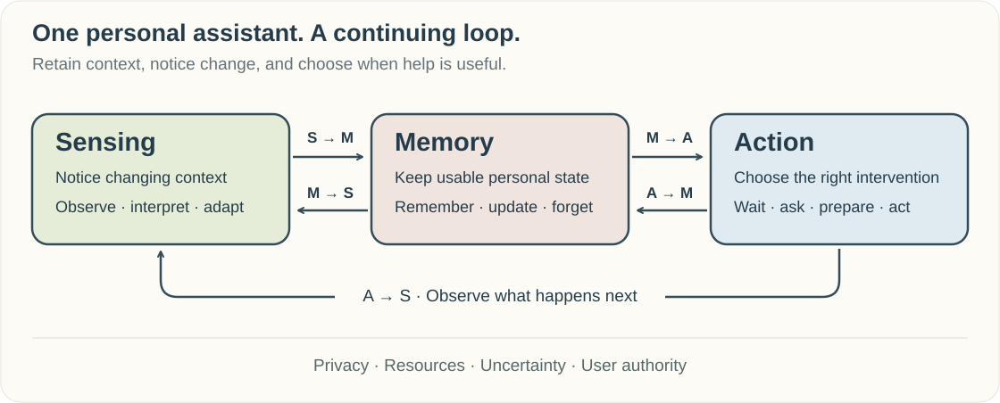
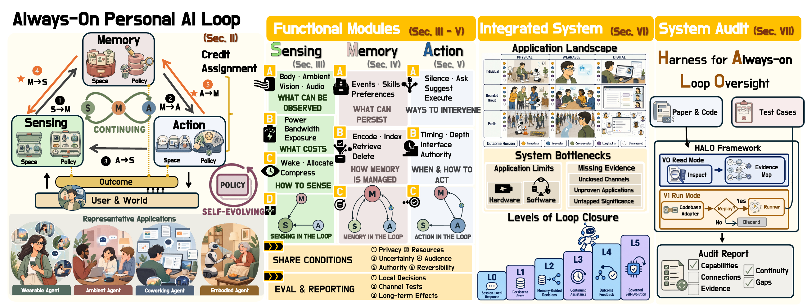

<!-- Generated by scripts/build_readme.py. Edit data/*.json or docs/readme-intro.md. -->
<div align="center">


[](https://awesome.re) [](https://always-on-agent.github.io/assets/always-on-personal-ai.pdf) [](https://always-on-agent.github.io/) [](CONTRIBUTING.md) [](https://github.com/Always-On-Agent/awesome-always-on-personal-ai)

A curated collection of research, systems, products, and building blocks for personal AI that stays useful across interactions.

**[Research](#sensing)** &nbsp; · &nbsp; **[Systems](#systems)** &nbsp; · &nbsp; **[Products](#products)** &nbsp; · &nbsp; **[Benchmarks](#evaluation)** &nbsp; · &nbsp; **[Contribute](CONTRIBUTING.md)**

<sub>89 research resources · 10 products · 10 developer tools</sub>

</div>

<a id="news"></a>
## News

- **2026-09-15** — Introduced an eight-category collection, a dedicated product directory, and structured contribution guidelines alongside the current survey draft.

<a id="overview"></a>
## What makes personal AI always-on?

**Always-on personal AI sustains assistance between explicit requests and retains usable personal state across interactions.** It can wake on a schedule or a relevant event, carry unfinished commitments forward, and decide when to act, ask, or stay silent. Continuous operation does not require continuous recording or inference.

Our survey organizes this behavior around **Sensing**, **Memory**, and **Action**. Governed **self-evolution** adds a further requirement: using attributed outcomes to propose, validate, and durably commit changes to future behavior.

<p align="center">
  
</p>

<details>
<summary><b>Explore the full survey framework and reading guide</b></summary>

<p align="center"></p>

- **New to the topic?** Start with [Surveys & Foundations](#surveys), then [Integrated Systems](#systems).
- **Studying a mechanism?** Explore [Sensing](#sensing), [Memory](#memory), and [Action](#action).
- **Building an assistant?** Browse [Tools & Infrastructure](#tools) and [Benchmarks & Datasets](#evaluation).
- **Looking for something to use?** Go directly to [Products](#products).
- **Studying feedback and self-evolution?** Follow the `Self-evolution` tags and the [five-channel guide](docs/taxonomy.md).

This collection includes enabling methods and partial systems as well as continuing assistants. Inclusion does not imply that a work demonstrates every capability of a full always-on loop.

</details>
<a id="contents"></a>
## Browse the collection

- [Surveys & Foundations](#surveys) · **8**
- [Sensing & Context Awareness](#sensing) · **11**
- [Memory & Personalization](#memory) · **14**
- [Proactive Action & Continuous Execution](#action) · **12**
- [Integrated Systems & Applications](#systems) · **23**
- [Benchmarks & Datasets](#evaluation) · **21**
- [Products](#products) · **10**
- [Tools & Infrastructure](#tools) · **10**

Entries have one primary home. Research is ordered by year, newest first, then by title; products and tools are alphabetical within each group. See the [scope and taxonomy](docs/taxonomy.md) for inclusion rules and cross-cutting themes.

---

<a id="surveys"></a>
##  Surveys & Foundations

Orient yourself in personal, proactive, and persistent assistance.

<a id="surveys-surveys"></a>
### Surveys & Roadmaps

- ` arXiv 2026 ` **[Always-On Agents: A Survey of Persistent Memory, State, and Governance in LLM Agents](https://arxiv.org/abs/2606.30306)**<br>
  Reviews persistent memory, agent state, and governance for assistants that continue operating across interactions. ` Survey `

- ` arXiv 2026 ` **[From Chatbot to Digital Colleague: The Paradigm Shift Toward Persistent Autonomous AI](https://arxiv.org/abs/2606.14502)**<br>
  Examines persistent autonomous AI through workspaces, reusable capabilities, and governance. ` Survey ` ` Digital `

- ` arXiv 2025 ` **[Building Egocentric Procedural AI Assistant: Methods, Benchmarks, and Challenges](https://arxiv.org/abs/2511.13261)** · [Project](https://github.com/z1oong/Building-Egocentric-Procedural-AI-Assistant)<br>
  Reviews step understanding, error detection, and evaluation for egocentric procedural assistants. ` Survey ` ` Wearable `

- ` arXiv 2024 ` **[A Survey on the Memory Mechanism of Large Language Model based Agents](https://arxiv.org/abs/2404.13501)** · [Project](https://github.com/nuster1128/LLM_Agent_Memory_Survey)<br>
  Surveys memory mechanisms that let language agents retain and reuse information beyond a single interaction. ` Survey `

- ` IJCAI 2023 ` **[A Survey on Proactive Dialogue Systems: Problems, Methods, and Prospects](https://arxiv.org/abs/2305.02750)**<br>
  Organizes proactive dialogue around system initiative, planning, and interaction goals. ` Survey `


<a id="surveys-foundations"></a>
### Foundations of Personal & Proactive Assistants

- ` TMLR 2024 ` **[Cognitive Architectures for Language Agents](https://arxiv.org/abs/2309.02427)**<br>
  Provides a cognitive architecture for organizing language-agent memory, actions, and decision processes. ` Foundational `

- ` UbiComp 2006 ` **[SenseCam: A Retrospective Memory Aid](https://www.microsoft.com/en-us/research/publication/sensecam-retrospective-memory-aid/)**<br>
  Demonstrates sensor-triggered wearable image capture and later review as an early approach to personal memory assistance. ` Foundational ` ` Wearable `

- ` CHI 1999 ` **[Principles of Mixed-Initiative User Interfaces](https://www.microsoft.com/en-us/research/publication/principles-mixed-initiative-user-interfaces/)**<br>
  Establishes principles for coordinating automated assistance with user goals, attention, uncertainty, and control. ` Foundational ` ` User control `


[↑ Back to collection](#contents)

---

<a id="sensing"></a>
##  Sensing & Context Awareness

Notice relevant changes and decide what to observe, when, and at what cost.

<a id="sensing-context"></a>
### Multimodal & Digital Context Understanding

- ` arXiv 2024 ` **[ChainStream: An LLM-based Framework for Unified Synthetic Sensing](https://arxiv.org/abs/2412.15240)** · [Code](https://github.com/MobileLLM/ChainStream)<br>
  Builds context-processing pipelines from heterogeneous sensor streams using language-model-generated programs. ` Multimodal `

- ` arXiv 2024 ` **[OmniParser for Pure Vision Based GUI Agent](https://arxiv.org/abs/2408.00203)**<br>
  Turns interface screenshots into structured elements for grounding computer-use actions. ` Digital `


<a id="sensing-streaming"></a>
### Streaming Perception & Event Detection

- ` ICLR 2026 ` **[StreamingVLM: Real-Time Understanding for Infinite Video Streams](https://arxiv.org/abs/2510.09608)** · [Code](https://github.com/mit-han-lab/streaming-vlm)<br>
  Maintains bounded working context for real-time understanding of video streams of unbounded length. ` Streaming `

- ` arXiv 2024 ` **[Flash-VStream: Memory-Based Real-Time Understanding for Long Video Streams](https://arxiv.org/abs/2406.08085)** · [Project](https://invinciblewyq.github.io/vstream-page/)<br>
  Uses memory-based video processing to support real-time questions over long incoming streams. ` Streaming `

- ` arXiv 2024 ` **[Moshi: a speech-text foundation model for real-time dialogue](https://arxiv.org/abs/2410.00037)** · [Code](https://github.com/kyutai-labs/moshi)<br>
  Models simultaneous listening and speaking as an enabling component for continuous voice interaction. ` Audio ` ` Streaming `

- ` CVPR 2024 ` **[VideoLLM-online: Online Video Large Language Model for Streaming Video](https://arxiv.org/abs/2406.11816)** · [Project](https://showlab.github.io/videollm-online)<br>
  Adapts video-language modeling to process incoming frames and produce responses during an ongoing stream. ` Streaming `

- ` Odyssey 2020 ` **[Personal VAD: Speaker-Conditioned Voice Activity Detection](https://arxiv.org/abs/1908.04284)**<br>
  Detects a target speaker's speech in streaming audio to support speaker-aware voice interfaces. ` Audio `


<a id="sensing-adaptive"></a>
### Adaptive & Efficient Sensing

- ` IEEE TVCG / ISMAR 2025 ` **[EgoTrigger: Toward Audio-Driven Image Capture for Human Memory Enhancement in All-Day Energy-Efficient Smart Glasses](https://arxiv.org/abs/2508.01915)**<br>
  Uses lightweight audio cues to trigger camera capture while preserving information useful for later episodic recall. ` Wearable `

- ` arXiv 2025 ` **[Full System Architecture Modeling for Wearable Egocentric Contextual AI](https://arxiv.org/abs/2512.16045)**<br>
  Models full-device power and architectural trade-offs for sustained egocentric contextual AI workloads. ` Wearable `

- ` IMWUT 2024 ` **[Kirigami: Lightweight Speech Filtering for Privacy-Preserving Activity Recognition using Audio](https://mynkgoel.github.io/pdfs/kirigami.pdf)**<br>
  Filters speech on resource-constrained devices while retaining ambient sounds for activity recognition. ` Privacy ` ` Audio `

- ` IEEE TMC 2020 ` **[DeepWear: Adaptive Local Offloading for On-Wearable Deep Learning](https://arxiv.org/abs/1712.03073)**<br>
  Adaptively partitions and offloads wearable inference to manage latency, energy, and limited device resources. ` Wearable `


[↑ Back to collection](#contents)

---

<a id="memory"></a>
##  Memory & Personalization

Keep personal context useful, current, and correctable across interactions.

<a id="memory-personal"></a>
### Personal, Episodic & Semantic Memory

- ` NeurIPS 2025 ` **[A-MEM: Agentic Memory for LLM Agents](https://arxiv.org/abs/2502.12110)** · [Code](https://github.com/WujiangXu/A-mem)<br>
  Organizes memories as linked notes whose connections and descriptions can change as new experience arrives. ` Memory organization `

- ` arXiv 2025 ` **[Memory OS of AI Agent](https://arxiv.org/abs/2506.06326)** · [Code](https://github.com/BAI-LAB/MemoryOS)<br>
  Combines short-, mid-, and long-term storage with memory updates for personalized conversations. ` Personalization `

- ` arXiv 2025 ` **[MemOS: A Memory OS for AI System](https://arxiv.org/abs/2507.03724)**<br>
  Treats plaintext, activation, and parameter memories as manageable resources with provenance and lifecycle operations. ` Multimodal `

- ` arXiv 2025 ` **[MIRIX: Multi-Agent Memory System for LLM-Based Agents](https://arxiv.org/abs/2507.07957)**<br>
  Combines multiple memory types to retain and retrieve long-term conversational and visual user context. ` Multimodal `

- ` arXiv 2023 ` **[MemGPT: Towards LLMs as Operating Systems](https://arxiv.org/abs/2310.08560)**<br>
  Manages multiple memory tiers and control flow to support conversation beyond a model's context window. ` Personalization `

- ` arXiv 2023 ` **[MemoryBank: Enhancing Large Language Models with Long-Term Memory](https://arxiv.org/abs/2305.10250)**<br>
  Maintains and updates interaction memories and user summaries for long-term conversational personalization. ` Personalization `


<a id="memory-modeling"></a>
### User Modeling & Personalization

- ` arXiv 2026 ` **[Learning Personalized Agents from Human Feedback](https://arxiv.org/abs/2602.16173)**<br>
  Uses clarification, remembered preferences, and post-action feedback to adapt to changing users in simulated tasks. ` Personalization ` ` User feedback `

- ` arXiv 2026 ` **[User as Code: Executable Memory for Personalized Agents](https://arxiv.org/abs/2606.16707)**<br>
  Represents user facts and rules as executable state that supports aggregation, contradiction handling, and triggered checks. ` Personalization `


<a id="memory-lifecycle"></a>
### Memory Management, Updating & Forgetting

- ` ICLR 2026 ` **[Agentic Context Engineering: Evolving Contexts for Self-Improving Language Models](https://arxiv.org/abs/2510.04618)**<br>
  Maintains evolving context playbooks through generation, reflection, and curation of reusable guidance. ` Self-evolution `

- ` ICLR 2026 ` **[LightMem: Lightweight and Efficient Memory-Augmented Generation](https://arxiv.org/abs/2510.18866)** · [Code](https://github.com/zjunlp/LightMem)<br>
  Separates lightweight sensory filtering, short-term consolidation, and offline memory updates to reduce memory-management cost. ` Personalization `

- ` arXiv 2026 ` **[MemPrivacy: Privacy-Preserving Personalized Memory Management for Edge-Cloud Agents](https://arxiv.org/abs/2605.09530)**<br>
  Masks sensitive spans before cloud memory processing and restores values locally to preserve useful personal context. ` Privacy `

- ` arXiv 2026 ` **[MemQ: Integrating Q-Learning into Self-Evolving Memory Agents over Provenance DAGs](https://arxiv.org/abs/2605.08374)** · [Code](https://github.com/jwliao-ai/MemQ)<br>
  Propagates outcome credit through memory-provenance chains to guide which experiences agents reuse. ` Self-evolution `

- ` ICLR 2026 ` **[ReasoningBank: Scaling Agent Self-Evolving with Reasoning Memory](https://arxiv.org/abs/2509.25140)** · [Code](https://github.com/google-research/reasoning-bank)<br>
  Distills reusable reasoning guidance from successful and failed agent trajectories for later tasks. ` Self-evolution `

- ` arXiv 2025 ` **[Memory-R1: Enhancing Large Language Model Agents to Manage and Utilize Memories via Reinforcement Learning](https://arxiv.org/abs/2508.19828)**<br>
  Learns memory add, update, delete, and retrieval decisions from downstream task rewards. ` Policy learning `


[↑ Back to collection](#contents)

---

<a id="action"></a>
##  Proactive Action & Continuous Execution

Choose whether to wait, ask, communicate, prepare, or execute, and follow up on the result.

<a id="action-initiative"></a>
### Initiative, Timing & Interruptibility

- ` arXiv 2026 ` **[Communication Policy Evolution for Proactive LLM Agents](https://arxiv.org/abs/2606.14314)**<br>
  Refines text and interface communication policies using rollouts and prompt updates under simulated user preferences. ` Self-evolution `

- ` NeurIPS 2025 ` **[StreamBridge: Turning Your Offline Video Large Language Model into a Proactive Streaming Assistant](https://arxiv.org/abs/2505.05467)**<br>
  Adds a compressed memory buffer and an activation model to enable proactive responses from offline video-language models. ` Streaming `

- ` Findings of EMNLP 2024 ` **[Large Language Models Know What To Say But Not When To Speak](https://arxiv.org/abs/2410.16044)**<br>
  Studies failures to recognize appropriate speaking opportunities within natural, unscripted conversation. ` Audio `

- ` arXiv 2024 ` **[Proactive Agent: Shifting LLM Agents from Reactive Responses to Active Assistance](https://arxiv.org/abs/2410.12361)**<br>
  Learns whether to initiate assistance from activity traces and human judgments of proposed tasks. ` Digital `

- ` arXiv 2024 ` **[VideoLLM Knows When to Speak: Enhancing Time-Sensitive Video Comprehension with Video-Text Duet Interaction Format](https://arxiv.org/abs/2411.17991)**<br>
  Uses interleaved video-text interaction to train models to respond at relevant moments during video playback. ` Streaming `

- ` Annals of Behavioral Medicine 2018 ` **[Just-in-Time Adaptive Interventions (JITAIs) in Mobile Health: Key Components and Design Principles for Ongoing Health Behavior Support](https://academic.oup.com/abm/article/52/6/446/4733473)**<br>
  Defines decision points, tailoring variables, and intervention rules for support that responds to changing personal context. ` Foundational `


<a id="action-continuation"></a>
### Monitoring, Follow-up & Task Continuation

- ` arXiv 2026 ` **[Anticipate and Learn: Unleashing Idle-Time Compute in Proactive Agents](https://arxiv.org/abs/2605.25971)**<br>
  Uses idle time, dialogue history, and persistent memory to acquire evidence for anticipated future user needs. ` Personalization `

- ` ACL 2026 ` **[ProActor: Timing-Aware Reinforcement Learning for Proactive Task Scheduling Agents](https://aclanthology.org/2026.acl-long.832/)**<br>
  Learns when to schedule proactive tasks by incorporating intervention timing into reinforcement learning. ` Digital `


<a id="action-execution"></a>
### Tool Use, Execution & Feedback

- ` CVPR 2025 ` **[Code-as-Monitor: Constraint-aware Visual Programming for Reactive and Proactive Robotic Failure Detection](https://arxiv.org/abs/2412.04455)**<br>
  Generates executable visual constraints to monitor robotic progress and detect or anticipate execution failures. ` Tool use `

- ` Findings of EMNLP 2024 ` **[Ask-before-Plan: Proactive Language Agents for Real-World Planning](https://arxiv.org/abs/2406.12639)**<br>
  Combines clarification, tool-based information gathering, and planning when user requests leave important details unresolved. ` Tool use `

- ` ICLR 2023 ` **[ReAct: Synergizing Reasoning and Acting in Language Models](https://arxiv.org/abs/2210.03629)** · [Project](https://react-lm.github.io)<br>
  Provides an enabling pattern for interleaving reasoning, environmental observations, and tool actions. ` Foundational ` ` Tool use `

- ` CoRL 2023 ` **[Robots That Ask For Help: Uncertainty Alignment for Large Language Model Planners](https://proceedings.mlr.press/v229/ren23a.html)**<br>
  Calibrates uncertainty in robotic language planning so the robot can request human help when needed. ` User control `


[↑ Back to collection](#contents)

---

<a id="systems"></a>
##  Integrated Systems & Applications

Study how sensing, memory, and action work together in real service settings. These are research systems; their demonstrated scope varies.

<a id="systems-daily"></a>
### Situated Daily Assistance

- ` arXiv 2026 ` **[LightMem-Ego: Your AI Memory for Everyday Life](https://arxiv.org/abs/2607.11487)** · [Code](https://github.com/zjunlp/LightMem-Ego)<br>
  Maintains aligned audio-visual memories across multiple timescales for later recall on phones and AI glasses. ` Wearable ` ` Multimodal `

- ` IEEE VRW 2026 ` **[Memento: Towards Proactive Visualization of Everyday Memories with Personal Wearable AR Assistant](https://arxiv.org/abs/2601.17622)**<br>
  Uses retained everyday memories for context-triggered AR recall and lets users remove unwanted records. ` Wearable ` ` User control `

- ` IMWUT 2026 ` **[Pro²Assist: Continuous Step-aware Proactive Assistance with Multi-modal Egocentric Perception for Long-horizon Procedural Tasks](https://arxiv.org/abs/2605.04227)**<br>
  Tracks procedural progress from multimodal egocentric input to provide step-aware guidance throughout a task. ` Wearable `

- ` ECCV 2026 ` **[Vinci2: Providing Proactive Assistance in Continuous Egocentric Videos](https://arxiv.org/abs/2607.11523)** · [Project](https://sitonggong.github.io/EgoServe-page/)<br>
  Combines temporal summaries, semantic memory, and visual retrieval to decide when assistance is warranted in continuous egocentric video. ` Wearable ` ` Personalization `

- ` arXiv 2026 ` **[VisionClaw: Always-On AI Agents through Smart Glasses](https://arxiv.org/abs/2604.03486)**<br>
  Connects live smart-glasses perception to an agent that executes tasks through external tools. ` Wearable ` ` Tool use `

- ` arXiv 2025 ` **[AI for Service: Proactive Assistance with AI Glasses](https://arxiv.org/abs/2510.14359)**<br>
  Presents a glasses-based architecture for context-driven, proactive assistance in everyday scenarios. ` Wearable `

- ` NeurIPS 2025 ` **[ContextAgent: Context-Aware Proactive LLM Agents with Open-World Sensory Perceptions](https://arxiv.org/abs/2505.14668)** · [Code](https://github.com/openaiotlab/ContextAgent)<br>
  Combines wearable sensory context and historical personas to predict assistance needs and invoke relevant tools. ` Wearable ` ` Tool use `

- ` EMNLP 2025 ` **[Proactive Assistant Dialogue Generation from Streaming Egocentric Videos](https://arxiv.org/abs/2506.05904)** · [Project](https://pro-assist.github.io/)<br>
  Learns context-sensitive guidance from streaming egocentric video using synthesized assistant dialogues. ` Wearable ` ` Streaming `

- ` arXiv 2025 ` **[ProAgent: Harnessing On-Demand Sensory Contexts for Proactive LLM Agent Systems in the Wild](https://arxiv.org/abs/2512.06721)**<br>
  Selects sensory context on demand and incorporates feedback-derived personas when deciding whether to assist. ` Wearable ` ` Personalization `

- ` UIST 2025 ` **[ProMemAssist: Exploring Timely Proactive Assistance Through Working Memory Modeling in Multi-Modal Wearable Devices](https://arxiv.org/abs/2507.21378)**<br>
  Models a wearer's working memory to select useful assistance moments while accounting for interruption cost. ` Wearable `

- ` arXiv 2024 ` **[Vinci: A Real-time Embodied Smart Assistant based on Egocentric Vision-Language Model](https://arxiv.org/abs/2412.21080)** · [Code](https://github.com/OpenGVLab/vinci)<br>
  Combines portable egocentric vision-language perception with real-time assistance in everyday activities. ` Wearable `


<a id="systems-conversation"></a>
### Conversation & Meeting Assistance

- ` arXiv 2026 ` **[LTS-VoiceAgent: A Listen-Think-Speak Framework for Efficient Streaming Voice Interaction via Semantic Triggering and Incremental Reasoning](https://arxiv.org/abs/2601.19952)**<br>
  Coordinates listening, background reasoning, and speaking with semantic triggers for streaming voice interaction. ` Audio ` ` Streaming `

- ` Findings of ACL 2025 ` **[LlamaPIE: Proactive In-Ear Conversation Assistants](https://aclanthology.org/2025.findings-acl.710/)**<br>
  Delivers discreet in-ear conversation assistance with decisions about when to speak. ` Wearable ` ` Audio `

- ` IMWUT 2025 ` **[SocialMind: LLM-based Proactive AR Social Assistive System with Human-like Perception for In-situ Live Interactions](https://arxiv.org/abs/2412.04036)**<br>
  Uses verbal, nonverbal, and social context to provide proactive AR suggestions during live interactions. ` Wearable ` ` Multimodal `


<a id="systems-digital"></a>
### Digital Workspace & Personal Services

- ` arXiv 2026 ` **[A Self-Evolving Agent for Longitudinal Personal Health Management](https://arxiv.org/abs/2607.13940)** · [Code](https://github.com/HC-Guo/HealthClaw)<br>
  Updates personal profiles, procedures, and episodic records for longitudinal health support evaluated on synthetic trajectories. ` Simulation ` ` Self-evolution `

- ` arXiv 2026 ` **[KnowAct-GUIClaw: Know Deeply, Act Perfectly, Personal GUI Assistant with Self-Evolving Memory and Skill](https://arxiv.org/abs/2607.12625)**<br>
  Combines personal experience memory, GUI execution, and reusable skill updates across device platforms. ` Digital ` ` Self-evolution `

- ` arXiv 2026 ` **[Ouroboros: A Self-Developing Frontier Coding Agent with Reviewed Core Evolution](https://arxiv.org/abs/2608.08311)**<br>
  Reports reviewed changes to a coding agent's tools, prompts, and implementation that become the runtime for later work. ` Digital ` ` Self-evolution `

- ` arXiv 2026 ` **[PASK: Toward Intent-Aware Proactive Agents with Long-Term Memory](https://arxiv.org/abs/2604.08000)**<br>
  Combines streaming intent detection, long-term memory, and a proactive-agent runtime to identify latent user needs. ` Digital ` ` Personalization `

- ` ICLR 2026 ` **[ProPerSim: Developing Proactive and Personalized AI Assistants through User-Assistant Simulation](https://arxiv.org/abs/2509.21730)**<br>
  Studies feedback-adapted proactive recommendations through ProPerAssistant in simulated household interactions. ` Simulation ` ` Self-evolution `

- ` arXiv 2025 ` **["Having Lunch Now": Understanding How Users Engage with a Proactive Agent for Daily Planning and Self-Reflection](https://arxiv.org/abs/2509.24073)**<br>
  Studies scheduled planning and reflection check-ins with a proactive assistant over a 14-day deployment. ` Digital ` ` Longitudinal `


<a id="systems-physical"></a>
### Physical Assistance & Collaboration

- ` arXiv 2026 ` **[Learning to Assist: Collaborative VLAs for Implicit Human-Robot Collaboration](https://arxiv.org/abs/2606.12475)**<br>
  Studies premature robotic assistance and steers action timing during collaborative assembly with humans. ` User control `

- ` IROS 2025 ` **[AssistantX: An LLM-Powered Proactive Assistant in Collaborative Human-Populated Environments](https://arxiv.org/abs/2409.17655)** · [Project](https://assistantx-agent.github.io/AssistantX/)<br>
  Coordinates office tasks through perception, memory, execution checks, and proactive requests for human collaboration. ` Longitudinal ` ` Tool use `

- ` arXiv 2025 ` **[Mixed-Initiative Dialog for Human-Robot Collaborative Manipulation](https://arxiv.org/abs/2508.05535)** · [Project](https://robin-lab.cs.utexas.edu/MicoBot/)<br>
  Uses mixed-initiative dialogue to negotiate task allocation with human partners during collaborative manipulation. ` User control `


[↑ Back to collection](#contents)

---

<a id="evaluation"></a>
##  Benchmarks & Datasets

Evaluate component capabilities, intervention timing, continuing tasks, and outcomes over time.

**From our survey — [HALO: Harness for Always-on Loop Oversight](https://always-on-agent.github.io/#halo).** A protocol for source-based review and scoped execution. The survey reports a read-mode review of 31 configurations; run mode describes a protocol rather than new benchmark results.

<a id="evaluation-sensing"></a>
### Sensing & Streaming Understanding

- ` CVPR 2025 ` **[EgoLife: Towards Egocentric Life Assistant](https://arxiv.org/abs/2503.03803)**<br>
  Provides extended multimodal daily-life recordings and assistant-oriented tasks for egocentric memory and reasoning. ` Wearable ` ` Longitudinal `

- ` CVPR 2025 ` **[OVO-Bench: How Far is Your Video-LLMs from Real-World Online Video Understanding?](https://arxiv.org/abs/2501.05510)** · [Code](https://github.com/JoeLeelyf/OVO-Bench)<br>
  Tests online video understanding across backward tracing, current perception, and forward reasoning. ` Streaming `

- ` arXiv 2025 ` **[TeleEgo: Benchmarking Egocentric AI Assistants in the Wild](https://arxiv.org/abs/2510.23981)**<br>
  Evaluates egocentric assistants on streaming daily-life understanding and long-term memory. ` Wearable ` ` Longitudinal `

- ` arXiv 2025 ` **[WearVox: An Egocentric Multichannel Voice Assistant Benchmark for Wearables](https://arxiv.org/abs/2601.02391)**<br>
  Evaluates wearable voice assistants using egocentric multichannel audio with realistic speakers and background noise. ` Wearable ` ` Audio `

- ` CVPR 2024 ` **[Ego-Exo4D: Understanding Skilled Human Activity from First- and Third-Person Perspectives](https://arxiv.org/abs/2311.18259)** · [Data](https://ego-exo4d-data.org/)<br>
  Pairs first- and third-person recordings to evaluate skilled activity understanding across viewpoints. ` Wearable ` ` Multimodal `

- ` CVPR 2022 ` **[Ego4D: Around the World in 3,000 Hours of Egocentric Video](https://arxiv.org/abs/2110.07058)** · [Data](https://ego4d-data.org/)<br>
  Provides first-person daily-life video and tasks for episodic memory, activity understanding, and forecasting. ` Wearable ` ` Multimodal `


<a id="evaluation-memory"></a>
### Long-Term Memory & Personalization

- ` arXiv 2026 ` **[MemConflict: Evaluating Long-Term Memory Systems Under Memory Conflicts](https://arxiv.org/abs/2605.20926)**<br>
  Tests how long-term memory systems resolve contradictory and changing information. ` Personalization `

- ` arXiv 2026 ` **[OP-Bench: Benchmarking Over-Personalization for Memory-Augmented Personalized Conversational Agents](https://arxiv.org/abs/2601.13722)**<br>
  Measures whether memory-augmented assistants apply personal context when it is irrelevant or inappropriate. ` Personalization ` ` User control `

- ` arXiv 2025 ` **[Evaluating Memory in LLM Agents via Incremental Multi-Turn Interactions](https://arxiv.org/abs/2507.05257)**<br>
  Evaluates incremental memory through retrieval, learning, long-range understanding, and selective forgetting tasks. ` Personalization `

- ` ICLR 2025 ` **[LongMemEval: Benchmarking Chat Assistants on Long-Term Interactive Memory](https://arxiv.org/abs/2410.10813)** · [Code](https://github.com/xiaowu0162/LongMemEval)<br>
  Tests extraction, temporal reasoning, updates, and abstention when assistants recall long interaction histories. ` Personalization `

- ` arXiv 2024 ` **[Evaluating Very Long-Term Conversational Memory of LLM Agents](https://arxiv.org/abs/2402.17753)**<br>
  Introduces LoCoMo for evaluating very long-term conversational memory across multi-session interactions. ` Personalization `


<a id="evaluation-proactive"></a>
### Proactive Assistance & Continuing Tasks

- ` arXiv 2026 ` **[IPIBench: Evaluating Interactive Proactive Intelligence of MLLMs under Continuous Streams](https://arxiv.org/abs/2605.27074)**<br>
  Evaluates when and how multimodal assistants intervene while receiving continuous input streams. ` Streaming `

- ` arXiv 2026 ` **[Plan, Watch, Recover: A Benchmark and Architectures for Proactive Procedural Assistance](https://arxiv.org/abs/2606.04970)**<br>
  Evaluates planning, monitoring, and recovery for proactive assistance during multistep procedures. ` Wearable `

- ` COLM 2026 ` **[PM-Bench: Evaluating Prospective Memory in LLM Agents](https://arxiv.org/abs/2607.12385)**<br>
  Evaluates whether agents remember pending intentions and execute them at appropriate later opportunities. ` Prospective memory `

- ` arXiv 2026 ` **[ProAgentBench: Evaluating LLM Agents for Proactive Assistance with Real-World Data](https://arxiv.org/abs/2602.04482)** · [Code](https://anonymous.4open.science/r/ProAgentBench-6BC0)<br>
  Separates intervention timing from assistance content using traces of real user workflows. ` Digital `

- ` arXiv 2026 ` **[TriggerBench: Investigating Prospective Memory for Large Language Models](https://arxiv.org/abs/2606.23459)** · [Code](https://github.com/KristenZHANG/TriggerBench-Official)<br>
  Tests whether models retain intentions and act when the relevant future event occurs. ` Prospective memory `

- ` arXiv 2026 ` **[π-Bench: Evaluating Proactive Personal Assistant Agents in Long-Horizon Workflows](https://arxiv.org/abs/2605.14678)**<br>
  Tests proactive personal assistants on workflows that require maintaining and acting on needs over long horizons. ` Digital ` ` Longitudinal `


<a id="evaluation-longitudinal"></a>
### End-to-End & Longitudinal Evaluation

- ` arXiv 2026 ` **[EvoMemBench: Benchmarking Agent Memory from a Self-Evolving Perspective](https://arxiv.org/abs/2605.18421)** · [Code](https://github.com/DSAIL-Memory/EvoMemBench)<br>
  Evaluates agent memory through experience accumulation and its effect on later performance. ` Self-evolution `

- ` arXiv 2026 ` **[PAST-Bench: Benchmarking the Foundations of Recursive Self-Improvement in Personal Agents](https://arxiv.org/abs/2608.04003)** · [Code](https://github.com/Gen-Verse/PAST-Bench)<br>
  Tests the foundations of recursive self-improvement in personal agents over streams of tasks. ` Longitudinal ` ` Self-evolution `

- ` arXiv 2026 ` **[SentinelBench: A Benchmark for Long-Running Monitoring Agents](https://arxiv.org/abs/2606.05342)**<br>
  Evaluates agents that must monitor evolving conditions and sustain correct decisions over long-running tasks. ` Longitudinal `

- ` Findings of EMNLP 2026 ` **[StreamMemBench: Streaming Evaluation of Agent Memory for Future-Oriented Assistance](https://arxiv.org/abs/2606.14571)** · [Code](https://github.com/landian60/StreamMemBench)<br>
  Evaluates how streaming memory supports assistance needs that arise after the original observations. ` Longitudinal ` ` Prospective memory `


[↑ Back to collection](#contents)

---

<a id="products"></a>
##  Products

User-facing products with capabilities relevant to always-on assistance. Descriptions reflect official documentation, not independent end-to-end evaluations. Availability can depend on plan, platform, region, or hardware.

[Source notes and availability details](docs/product-sources.md) · A capture or recall feature alone does not establish a complete continuing loop.

<a id="products-wearables"></a>
### Wearables & Ambient Devices

| Product / form | Relevant capability | Availability | Sources |
|:--|:--|:--|:--|
| **[Omi](https://www.omi.me/pages/product)**<br><sub>Pendant + companion apps</sub> | Turns recorded conversations into searchable memories, summaries, extracted tasks, and daily recaps through a wearable and companion apps. | Apps available; hardware stock varies<br><sub>Checked 2026-09-15</sub> | [Website](https://www.omi.me/pages/product) · [Code](https://github.com/BasedHardware/omi) · [Docs](https://help.omi.me/en/articles/12017447-omi-device-orders-shipping-what-to-expect) |
| **[PLAUD NotePin](https://www.plaud.ai/products/plaud-notepin)**<br><sub>Wearable recorder</sub> | Captures user-started in-person conversations for later transcription, summarization, and retrieval in the Plaud app. | Available; recording is manually started<br><sub>Checked 2026-09-15</sub> | [Website](https://www.plaud.ai/products/plaud-notepin) · [Docs](https://support.plaud.ai/hc/en-us/articles/50841183397273-Start-recording) |
| **[Ray-Ban Meta](https://www.meta.com/ai-glasses/ray-ban-meta/)**<br><sub>Smart glasses</sub> | Provides camera-grounded assistance, voice interaction, and user-set reminders through smart glasses paired with the Meta AI app. | Available; AI features vary by country/language<br><sub>Checked 2026-09-15</sub> | [Website](https://www.meta.com/ai-glasses/ray-ban-meta/) · [Docs](https://www.ray-ban.com/uk/c/frequently-asked-questions-ray-ban-meta-smart-glasses) |

<a id="products-apps"></a>
### Desktop & Mobile Assistants

| Product / form | Relevant capability | Availability | Sources |
|:--|:--|:--|:--|
| **[Claude Cowork](https://claude.com/product/cowork)**<br><sub>Desktop, web, and mobile</sub> | Runs delegated tasks across selected files and tools, with unattended scheduled work and results returned for review. | Paid plans; web/mobile rollout varies<br><sub>Checked 2026-09-15</sub> | [Website](https://claude.com/product/cowork) |
| **[screenpipe](https://screenpipe.com/)**<br><sub>Desktop app</sub> | Builds a searchable local history of screen and audio activity that users and connected agents can use for recall and follow-up work. | Available; open-source project and desktop app<br><sub>Checked 2026-09-15</sub> | [Website](https://screenpipe.com/) · [Code](https://github.com/screenpipe/screenpipe) · [Docs](https://docs.screenpi.pe/search-screen-history) |
| **[Windows Recall](https://support.microsoft.com/en-US/Windows/Ai/Ai-Features/retrace-your-steps-with-recall)**<br><sub>Windows feature</sub> | Stores opt-in screen snapshots locally and lets users search prior desktop activity with capture, filtering, and deletion controls. | Preview; supported Copilot+ PCs only<br><sub>Checked 2026-09-15</sub> | [Website](https://support.microsoft.com/en-US/Windows/Ai/Ai-Features/retrace-your-steps-with-recall) · [Docs](https://support.microsoft.com/en-us/windows/privacy/privacy-and-control-over-your-recall-experience) |

<a id="products-hosted"></a>
### Cloud & Messaging Assistants

| Product / form | Relevant capability | Availability | Sources |
|:--|:--|:--|:--|
| **[ChatGPT Pulse](https://openai.com/index/introducing-chatgpt-pulse/)**<br><sub>ChatGPT mobile feature</sub> | Uses chat history, memory, feedback, and optional connected apps to prepare personalized research briefings between conversations. | Preview documented; current access unconfirmed<br><sub>Checked 2026-09-15</sub> | [Website](https://openai.com/index/introducing-chatgpt-pulse/) |
| **[Lindy](https://www.lindy.ai/)**<br><sub>Web and messaging assistant</sub> | Uses connected inbox and calendar context to prepare meetings, draft replies, and handle post-meeting follow-ups. | Available; paid plans with trial<br><sub>Checked 2026-09-15</sub> | [Website](https://www.lindy.ai/) · [Docs](https://docs.lindy.ai/) |
| **[Muse](https://muse.ai/)**<br><sub>Web, iOS, Android, and WhatsApp</sub> | Combines persistent conversational memory with scheduled and event-driven background work, surfacing meaningful updates or requests for input. | Rolling out in the US<br><sub>Checked 2026-09-15</sub> | [Website](https://muse.ai/) · [Docs](https://introducing.muse.ai/) |
| **[OpenClaw](https://openclaw.ai/)**<br><sub>Self-hosted messaging assistant</sub> | Runs a personal assistant on user-managed infrastructure with durable memory, messaging access, and scheduled heartbeat checks or follow-ups. | Available; self-hosting and configuration required<br><sub>Checked 2026-09-15</sub> | [Website](https://openclaw.ai/) · [Code](https://github.com/openclaw/openclaw) · [Docs](https://docs.openclaw.ai/gateway/heartbeat) |

[↑ Back to collection](#contents)

---

<a id="tools"></a>
##  Tools & Infrastructure

Developer building blocks for personal state, continuing operation, and governed integrations. Open source is an attribute, not a separate research category.

<a id="tools-memory"></a>
### Memory & Personal Data Infrastructure

- **[Graphiti](https://github.com/getzep/graphiti)** · [Code](https://github.com/getzep/graphiti) · [Docs](https://help.getzep.com/graphiti/getting-started/welcome)<br>
  Builds temporal knowledge graphs from evolving interactions while retaining fact history and links to source episodes. ` Temporal memory ` ` Provenance `

- **[Letta](https://www.letta.com/)** · [Code](https://github.com/letta-ai/letta) · [Docs](https://docs.letta.com/configuration/memory)<br>
  Supports stateful agents with persistent editable memory and background consolidation of lessons from prior conversations. ` Persistent memory ` ` Consolidation `

- **[Mem0](https://mem0.ai/)** · [Code](https://github.com/mem0ai/mem0) · [Docs](https://docs.mem0.ai/introduction)<br>
  Adds retrievable long-term memories that persist across an agent's sessions, tools, and runs. ` Long-term memory ` ` Personalization `

- **[MemOS](https://github.com/MemTensor/MemOS)** · [Code](https://github.com/MemTensor/MemOS) · [Docs](https://memos-docs.openmem.net/)<br>
  Provides APIs to store, retrieve, edit, and delete persistent agent memory with asynchronous ingestion and feedback-based correction. ` Memory lifecycle ` ` Corrections `


<a id="tools-runtime"></a>
### Background Runtimes & Event Scheduling

- **[Inngest](https://www.inngest.com/)** · [Code](https://github.com/inngest/inngest) · [Docs](https://www.inngest.com/docs/features/events-triggers)<br>
  Triggers asynchronous background functions from application events, webhooks, or recurring schedules for ongoing agent workflows. ` Event triggers ` ` Scheduling `

- **[LangGraph](https://docs.langchain.com/oss/python/langgraph/overview)** · [Code](https://github.com/langchain-ai/langgraph) · [Docs](https://docs.langchain.com/oss/python/langgraph/persistence)<br>
  Uses persistent checkpoints and cross-thread stores to resume agent workflows and retain useful context across interactions. ` Task continuation ` ` Checkpoints `

- **[Temporal](https://temporal.io/)** · [Code](https://github.com/temporalio/temporal) · [Docs](https://docs.temporal.io/workflow-execution)<br>
  Preserves workflow execution state through failures so long-running background jobs can wait for events and resume work. ` Durable execution ` ` Recovery `


<a id="tools-integrations"></a>
### Integrations, Permissions & Observability

- **[Composio](https://composio.dev/)** · [Code](https://github.com/ComposioHQ/composio) · [Docs](https://docs.composio.dev/docs/triggers)<br>
  Connects agents to user-authorized app accounts and delivers app-event triggers that can start contextual background work. ` Connected apps ` ` Event triggers `

- **[Langfuse](https://langfuse.com/)** · [Code](https://github.com/langfuse/langfuse) · [Docs](https://langfuse.com/docs/observability/overview)<br>
  Records agent traces and evaluation signals to inspect failures, latency, and costs across ongoing assistance workflows. ` Observability ` ` Evaluation `

- **[Model Context Protocol (MCP)](https://modelcontextprotocol.io/)** · [Code](https://github.com/modelcontextprotocol/modelcontextprotocol) · [Docs](https://modelcontextprotocol.io/introduction)<br>
  Standardizes connections to external data and tools so personal agents can access authorized context and invoke application capabilities. ` Tool interfaces ` ` Context access `


[↑ Back to collection](#contents)

---

<a id="contributing"></a>
## Contributing

Have a relevant paper, benchmark, product, or tool to add? We welcome focused contributions. Please read [CONTRIBUTING.md](CONTRIBUTING.md), add one primary record to the appropriate file in [data/](data/), and regenerate this list:

```bash
python3 scripts/build_readme.py
python3 scripts/build_readme.py --check
```

You can also [suggest a resource](https://github.com/Always-On-Agent/awesome-always-on-personal-ai/issues/new?template=resource.yml) or report a correction. See the [taxonomy and inclusion rules](docs/taxonomy.md), [research provenance](docs/curation-notes.md), and [product source notes](docs/product-sources.md).

<a id="citation"></a>
## Citation

This collection accompanies **Always-On Personal AI: A Roadmap towards a Continuing and Self-Evolving Loop**. The paper is a working draft; author information and archival publication details will be updated when announced. [Read the current paper](https://always-on-agent.github.io/assets/always-on-personal-ai.pdf) · [Download BibTeX](citation.bib).

```bibtex
@misc{liu2026alwayson,
  title = {Always-On Personal AI: A Roadmap towards
           a Continuing and Self-Evolving Loop},
  author = {{Authors to be announced}},
  year = {2026},
  note = {Working draft},
  url = {https://always-on-agent.github.io/}
}
```

<a id="acknowledgments"></a>
## Acknowledgments

The organization and presentation were inspired by [Awesome Long-Horizon Agents](https://github.com/RUC-NLPIR/Awesome-Long-Horizon-Agents) and [Awesome Agentic World Modeling](https://github.com/matrix-agent/awesome-agentic-world-modeling). The banner, icons, and loop illustration were created for this repository; the survey figure is from our project.

Repository code and original curation text are available under the [MIT License](LICENSE). Linked papers, products, datasets, and third-party assets retain their respective licenses and terms.
